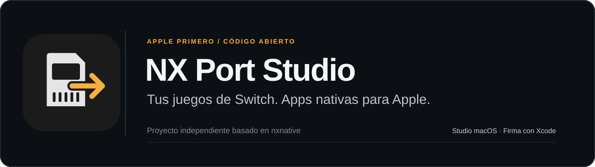
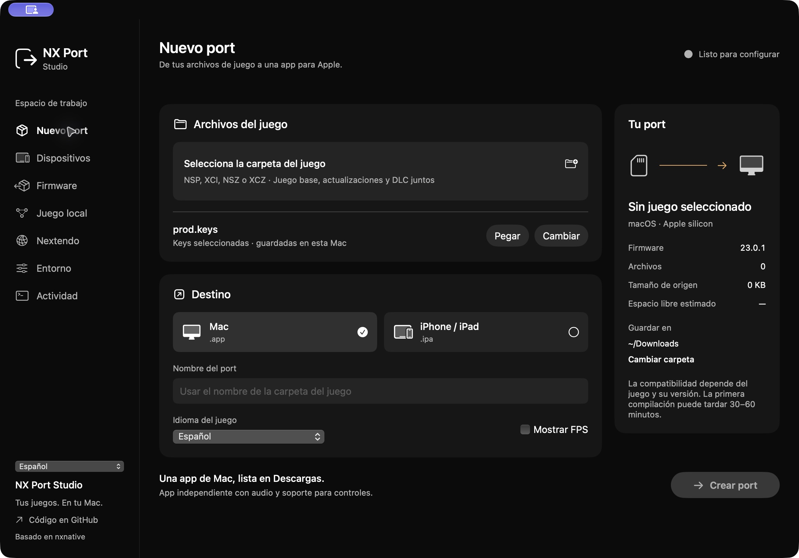
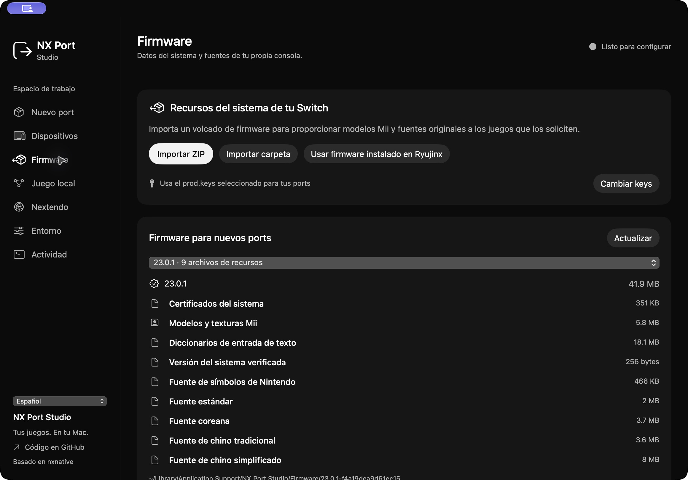
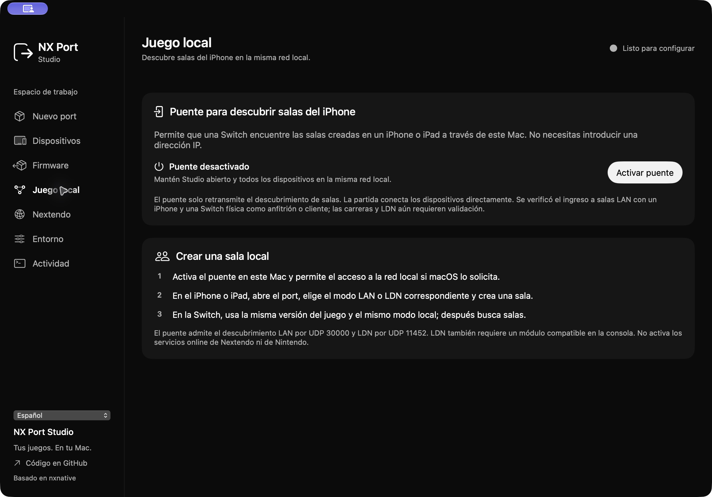

<p align="center">
  
</p>

<p align="center">
  <a href="#primeros-pasos">Primeros pasos</a> · <a href="#qué-está-verificado">Estado verificado</a> · <a href="ROADMAP.md">Hoja de ruta</a> · <a href="CONTRIBUTING.md">Colaborar</a> · <a href="CREDITS.md">Créditos</a>
</p>

<p align="center"><a href="README.md">English</a> · <strong>Español</strong> · <a href="README.fr.md">Français</a> · <a href="README.ja.md">日本語</a> · <a href="README.zh-Hans.md">简体中文</a></p>

**NX Port Studio es un espacio de trabajo para macOS que convierte tus propios archivos de juegos de Nintendo Switch en apps nativas para Apple.** Selecciona un juego, prepara las herramientas y recursos, y crea una app de Mac o un port de iPhone/iPad firmado mediante Xcode.

Es un proyecto independiente basado en [seedds/nxnative](https://github.com/seedds/nxnative). Se conservan el reconocimiento al motor original, sus autores y el aviso MIT. Consulta los [créditos](CREDITS.md) y la [licencia](LICENSE).

> **Candidata 1.6.0:** motor sincronizado con nxnative `d2a86b05ccce` (352 commits desde la base compartida). Pasan las pruebas automáticas de host, gráficos e iOS; falta repetir la validación de juegos con este motor. [Notas de versión](docs/releases/1.6.0-rc.3.md).

## Capturas de Studio

La importación reconoce ZIP/7z, subcarpetas y extensiones en mayúsculas, con extracción limitada y verificación de integridad. Los errores conocidos muestran pasos para resolverlos en los cinco idiomas de la interfaz.

Capturas de la app funcionando en macOS, en español.



| Recursos del sistema por versión | Descubrimiento de salas locales |
| :---: | :---: |
| [](docs/images/es/studio-firmware.jpg) | [](docs/images/es/studio-local-play.jpg) |

## Del archivo a la app

- **Progreso real:** una carpeta por juego con su base, actualizaciones y DLC; etapas y errores del motor visibles.
- **Exportación iOS firmada:** todos los IPA pasan por la firma de Xcode y la verificación del perfil. La instalación es opcional después de exportar correctamente.
- **Recursos originales:** importa datos de tu propio firmware para modelos Mii, fuentes y certificados, con comprobación de versión y contenido.
- **Controles nativos:** configuración por juego, movimiento y vibración cuando el sistema y el hardware conectado los exponen.
- **Redes con alcance claro:** LAN, puente LDN e integración Nextendo son rutas distintas, con pruebas propias.

El motor ejecuta código ARM64 reescrito del juego en Apple silicon e implementa servicios y traducción gráfica. La compatibilidad depende del juego, actualización, perfil y dispositivo exactos. Crear una app no demuestra por sí solo que el juego sea jugable.

## Más allá de la interfaz de compilación

El proyecto también amplía el runtime y las rutas de integración:

- [Sockets Horizon](dm/host/hle_net_backend.c): traducción de direcciones/errores/flags, TCP/UDP reales y cierre/reutilización de descriptores seguros.
- [Entrada HLE bloqueante](dm/host/entry.S): publicación de registros del juego, pilas nativas y esperas que respetan pausa/reanudación.
- [TLS de Apple](dm/host/hle_ssl_apple.m): verificación de certificados/hostname y confianza por contexto; el [importador de firmware](dm/tools/nx_extract/FirmwareResources.cs) aporta CertStore original.
- [Puente LDN original](dm/host/hle_ldn.c): descubrimiento, sesiones, participantes y sincronización reales; el usuario confirmó partidas LAN y LDN entre ports nativos Mac/iOS y una Switch física.
- [Puente nativo de cuenta](dm/host/hle_nextendo_apple.m) y [rutas del servicio](dm/host/hle_nextendo_routes.c): manejo explícito de credenciales/identidad; OAuth limitado no se convierte en una credencial de juego.
- [Mapeo de controles](dm/host/controls_map.h) y [ruta Joy-Con de Mac](dm/host/joycon_mac.inc): layouts Nintendo/Xbox, API públicas de Apple y acceso raw calibrado en Mac. En iOS se respetan las capacidades expuestas por sus API públicas.

Cada mecanismo tiene pruebas y alcances distintos. Esto no demuestra que todos los juegos puedan jugar online.

## Qué está verificado

| Área | Evidencia actual | Alcance |
| --- | --- | --- |
| Studio en macOS | Pasan las pruebas de compilación, configuración, procesos, recursos y firma Xcode. | Apple silicon; Studio requiere macOS 14+. Algunos juegos necesitan funciones más recientes de macOS/Metal. |
| LAN Mac ↔ Switch | Un build anterior probado **completó una carrera de Mario Kart 8 Deluxe 3.0.5** con una Switch física. | Es una referencia histórica con versiones coincidentes y modo LAN. El candidato actual no ha repetido esa carrera. |
| Puente LDN | El usuario confirmó juego LAN y LDN de Mario Kart 3.0.5 entre ports nativos Mac/iOS y una Switch física el 31 de octubre. También pasan las pruebas de protocolo. | Corresponde a los ports anteriores a esta sincronización; falta repetir la prueba con el nuevo motor. El puente LDN IP necesita un módulo compatible en la consola. |
| Nextendo | Se verificaron la cuenta y **una ronda real de arena de Smash 13.0.5 en Mac**. | Conexión automática y certificado exacto autorizado para ese servicio. Este resultado no valida partida rápida, otros juegos ni online en iOS. |
| iPhone/iPad | El usuario confirmó que el build firmado de Mario Kart 3.0.5 entra a salas LAN con una Switch física, con ambos dispositivos como anfitrión. | Está comprobada la entrada a la sala; falta validar una carrera completa. Siguen aplicando restricciones de dispositivo, firma y plataforma. |
| Android/Windows | Planeados después de estabilizar la base Apple. | Aún no hay builds ni compatibilidad anunciada; ARM y x86 requieren trabajo propio. |

## Primeros pasos

### Requisitos

- Mac con Apple silicon y macOS 14 o posterior para Studio; Xcode con Swift 6. El motor o un juego concreto pueden necesitar herramientas gráficas más recientes.
- Tus archivos de juegos y claves de consola. Las actualizaciones y DLC correspondientes van en la carpeta del mismo juego.
- Para iPhone/iPad: dispositivo físico apto, cuenta/equipo de desarrollo configurados en Xcode, emparejamiento, confianza y modo de desarrollador. Los objetivos actuales del motor utilizan iOS/iPadOS 26 y hardware A17 Pro/M-series compatible; revisa las notas del juego.

### Compilar Studio

Desde un checkout con el código de Studio y del motor:

```sh
cd macOS/NXPortStudio
swift test
swift run NXPortStudio
```

Crear un paquete local:

```sh
./scripts/package_app.sh "/ruta/NX Port Studio.app"
```

El script no sobrescribe un destino existente. Su firma ad-hoc predeterminada corresponde a la **app de Studio para Mac**; una distribución pública notarizada es otro paso. Los **IPA de juegos se firman con Xcode**, sujetos a las reglas de cuenta, dispositivo y vencimiento de Apple.

### Crear un port

1. Abre **Entorno** y prepara las herramientas que el motor indique como necesarias.
2. En **Nuevo port**, selecciona la carpeta del juego y tu `prod.keys`.
3. Opcionalmente importa tus recursos originales en **Firmware** y selecciona el catálogo para nuevos ports.
4. Elige **Mac** o **iPhone/iPad**. En iOS, selecciona un dispositivo apto emparejado e introduce tu Team ID de Xcode.
5. Crea el port. En iOS, la operación sólo termina correctamente después de firmar y verificar el IPA. **Instalar al terminar** controla la instalación, no la firma.

La interfaz inicia en español y permite elegir inglés, francés, japonés y chino simplificado en la barra lateral o en el menú Idioma. El idioma de la interfaz y el del juego se configuran por separado. La salida técnica mantiene su idioma original. Los ports de Mac se instalan directamente en **Aplicaciones** y eliminan automáticamente el motor temporal, la extracción y los archivos de compilación. Las actualizaciones verifican la nueva app antes de reemplazar un port del mismo juego. Las partidas y los ajustes permanecen en Application Support. Los proyectos de iOS y sus archivos extraídos se conservan junto al juego para la firma con Xcode; las exportaciones IPA se guardan en Descargas de forma predeterminada.

## Cada modo de red tiene requisitos distintos

Los ports arrancan con los servicios de conexión automáticos. Elige En línea, Inalámbrico o LAN dentro del juego, sin seleccionar otro modo ni reiniciar. Configurar Nextendo es una acción independiente: la falta de credenciales online no bloquea el juego local. La desconexión y la dirección de descubrimiento opcional quedan como ajustes avanzados.

**LAN:** utiliza el modo LAN propio del juego y sockets IP reales. Requiere versiones coincidentes y la misma red. La carrera del build anterior es la referencia física; no certifica un candidato posterior del runtime. El candidato actual 3.0.5 para Mac ya [crea una sala LAN local](dm/games/0100152000022000/README.md#local-network-validation) y llega al lobby y a las reglas del anfitrión. La incorporación de otro dispositivo y una nueva carrera siguen pendientes para ese candidato.

**LDN:** transporta por IP el descubrimiento y los participantes del servicio inalámbrico local. Requiere un peer/módulo compatible y un juego coincidente. Las pruebas entre procesos no sustituyen una comprobación física.

Algunos juegos también necesitan una identidad del historial local al preparar la sala. Importa tu propio firmware en Studio y selecciónalo antes de crear el port. El importador puede extraer ese recurso privado de un módulo friends reconocido; se ha validado el firmware 23.0.1. [La implementación y sus límites](docs/reference/services.md#local-play-history-identity-required-after-network-creation) se documentan por separado de las cuentas online.

**Nextendo:** integra autorización de cuenta y políticas firmadas del servicio. Studio utiliza el ID de tu aplicación registrada y guarda las credenciales en el Llavero de esta Mac. OAuth con permisos de cuenta no se convierte automáticamente en una credencial NEX de juego. Una solicitud explícita puede obtener una credencial NEX verificada contra la identidad; ese paso de cuenta ya fue comprobado. Un servidor habilitado, una versión aceptada y una credencial guardada describen requisitos distintos; ninguno demuestra una partida online nativa. Consulta la política vigente en el catálogo firmado de la app.

El port incluye **configuración de Nextendo desde el iPhone/iPad**: autorización en el navegador del sistema, cuenta en el Llavero de la app, actualización del catálogo firmado y comprobación de versión/servicios antes de iniciar. El flujo tiene pruebas con datos sintéticos; la autorización física en el navegador sigue en validación. Configurar la cuenta no confirma una partida nativa online.

En iOS, el runtime implementa el descubrimiento unicast automático en una subred IPv4 local apta y acotada cuando no dispone de broadcast/multicast. La dirección de peer avanzada es opcional. El usuario confirmó la entrada a salas LAN en ambos roles con una Switch física; falta validar una carrera completa.

Para las salas creadas en el iPhone/iPad, **Juego local → Activar puente** habilita un [puente de descubrimiento local](dm/net/lan_relay.c) opcional en el Mac. Mantén Studio abierto en la misma red. El puente retransmite el descubrimiento LAN/LDN compatible; la partida conecta directamente a los participantes. Se inicia apagado, muestra tráfico y errores reales, y no requiere cuenta ni introducir una IP. **La entrada a salas LAN está confirmada por el usuario en ambos roles. Las carreras y la interoperabilidad LDN siguen pendientes.**

### Bloqueos actuales de servicios de juego

Al 2026-10-31, cinco servicios de cuenta, BAAS y datos completan el handshake TLS nativo con la CA del proveedor, incluidos sus certificados de larga duración. El servidor NEX de MK8 probado aún presenta un certificado autofirmado sin el hostname requerido, y la cadena de autenticación de dispositivo/aplicación no coincide con la CA publicada. Esas comprobaciones siguen fallando. Mario Kart 8 Deluxe **3.0.5** también queda fuera del requisito **4.0.1**. El [inventario completo](docs/nextendo-coverage.md) incluye los 58 títulos, 62 perfiles regionales y 22 planes de parches por build; las partidas online nativas siguen pendientes de validación.

## Contenido del repositorio

Aquí van código, arte original del proyecto, perfiles, herramientas, documentación y licencias de dependencias. No van juegos, datos de juego descifrados, claves, archivos de firmware, credenciales ni partidas personales. No se publican capturas, portadas, arte, iconos de juegos ni archivos originales del SDK de Nintendo. Los resultados de validación se describen en texto.

Consulta [Contributing](CONTRIBUTING.md) y la [hoja de ruta](ROADMAP.md). Este proyecto no está afiliado con Nintendo, Apple, Nextendo ni los autores del motor original; utilizar un motor o servicio no implica su respaldo.
