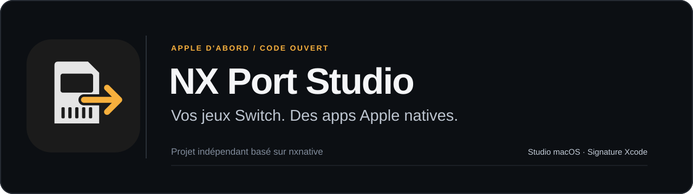
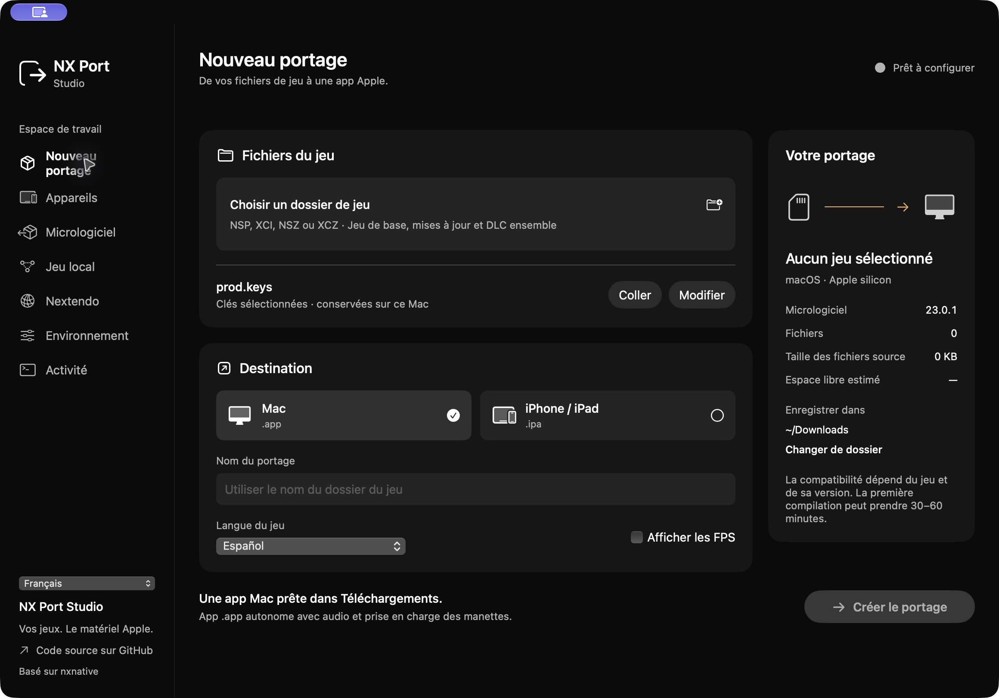
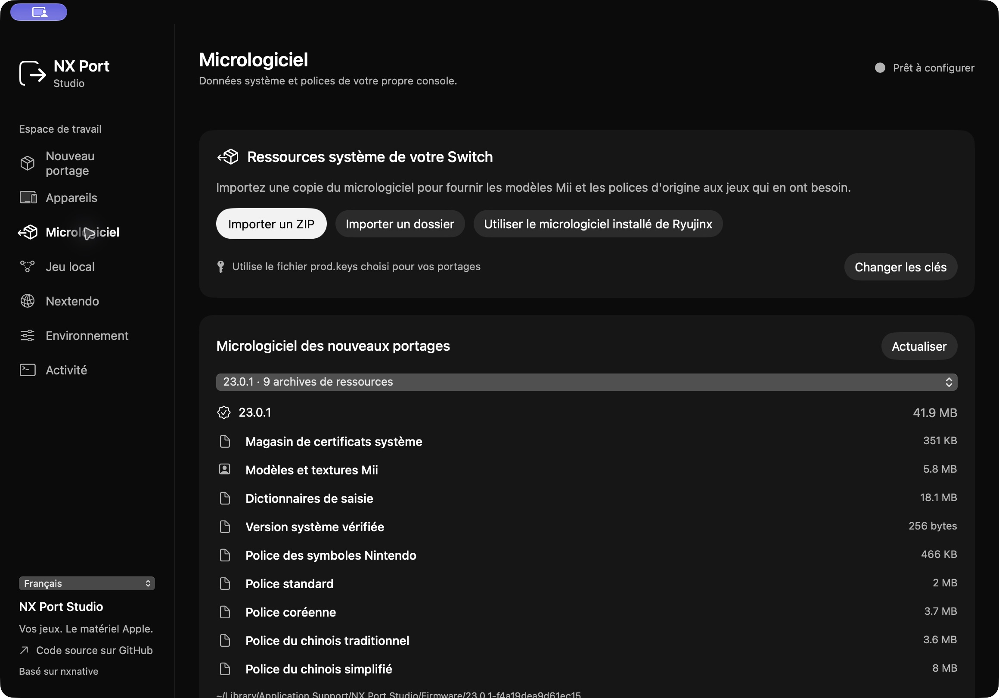
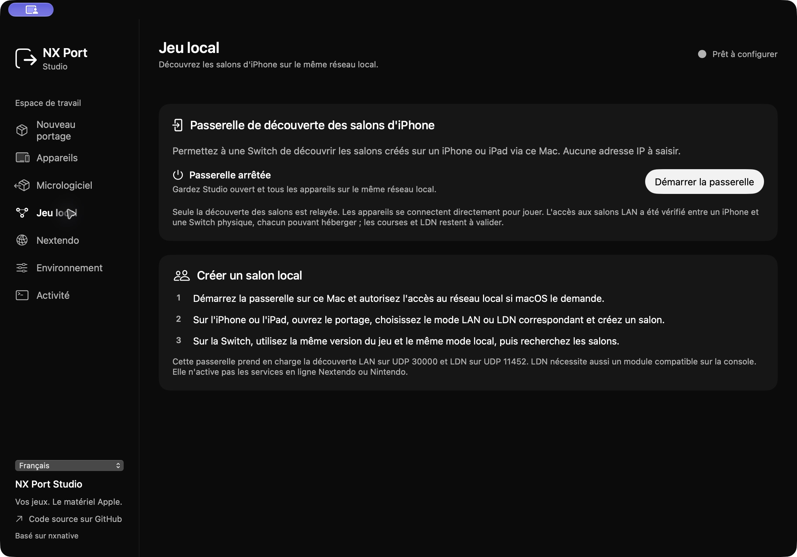

<a href="README.md">English</a> · <a href="README.es.md">Español</a> · <strong>Français</strong> · <a href="README.ja.md">日本語</a> · <a href="README.zh-Hans.md">简体中文</a>

**NX Port Studio transforme vos propres fichiers de jeux Nintendo Switch en applications natives pour les plateformes Apple.** L'espace de travail macOS rassemble la préparation des ressources, la compilation, les contrôles et la signature des ports iPhone/iPad avec Xcode.

Ce projet indépendant repose sur [nxnative de seedds](https://github.com/seedds/nxnative). Les auteurs du moteur et leurs avis de copyright restent crédités : [crédits](CREDITS.md), [licence MIT](LICENSE).

## Dans l'application

L'interface démarre en espagnol. Son sélecteur propose aussi l'anglais, le français, le japonais et le chinois simplifié. La langue de l'interface et celle du jeu se règlent séparément.

| Ressources du système | Découverte des salons locaux |
| :---: | :---: |
|  |  |

## Fonctionnalités

- Jeux de base, mises à jour et DLC dans un dossier par jeu, avec progression réelle et erreurs consultables.
- Exportations iOS signées par Xcode et vérifiées avant de signaler une réussite.
- Importation de vos ressources de firmware : modèles Mii, polices et certificats.
- Mappage des contrôles, mouvement et vibrations selon les capacités du système et des manettes.
- Transport réseau natif, découverte LAN/LDN et intégration expérimentale de Nextendo.

Le projet étend aussi le moteur : sockets Horizon, attentes HLE, vérification TLS, comptes et prise en charge des Joy-Con. La compatibilité dépend du jeu, de sa version et de l'appareil.

## État des essais

| Fonction | Résultat vérifié |
| --- | --- |
| LAN Mac ↔ Switch | Une version Mac antérieure a terminé une course complète de Mario Kart 8 Deluxe 3.0.5 avec une Switch physique. Le candidat actuel crée un salon et ouvre les règles de l'hôte. |
| LAN iPhone ↔ Switch | L'utilisateur a confirmé la participation au salon dans les deux sens, avec chaque appareil comme hôte. Aucune course complète n'est encore déclarée pour ce test. |
| LDN / mode sans fil | La découverte fonctionne lors du test physique actuel ; l'entrée et la création de salons rencontrent encore une erreur de connexion. Diagnostic en cours. |
| Nextendo | OAuth, obtention d'un identifiant NEX vérifié et catalogue signé validés. Aucune partie native en ligne n'est encore validée. |
| Android / Windows | Prévus après la stabilisation des plateformes Apple ; aucune version disponible. ARM et x86 nécessitent des travaux distincts. |

Pour le LAN, utilisez la même version du jeu et le même réseau local. Ce réseau peut fonctionner sans accès Internet. Le pont LDN sur IP exige un module compatible sur la console ; le mode LAN d'un jeu suit son propre protocole.

Au 28 octobre 2026, les essais Nextendo restent bloqués par des certificats de services et par la version disponible de Mario Kart : 3.0.5, alors que le catalogue signé demande 4.0.1. La connexion au compte ne résout pas ces exigences. Consultez le [README principal](README.md#current-game-service-blockers) pour les détails.

## Démarrage

Il faut un Mac Apple silicon, macOS 14 ou ultérieur pour Studio, Xcode avec Swift 6 et vos propres fichiers de jeux et clés. Les ports iOS actuels ciblent iOS/iPadOS 26 et le matériel pris en charge. Certains jeux exigent une version plus récente de macOS/Metal.

Depuis le dépôt :

    cd macOS/NXPortStudio
    swift test
    swift run NXPortStudio

Dans Studio, préparez l'environnement, choisissez le dossier du jeu et prod.keys, puis sélectionnez Mac ou iPhone/iPad. Pour iOS, configurez votre équipe Xcode et un appareil associé. Un IPA est réussi seulement après signature et vérification ; les règles d'Apple sur les comptes et l'expiration s'appliquent.

Le dépôt contient les sources, les outils et les captures de Studio. Les jeux, clés, firmwares, données de compte, sauvegardes et illustrations Nintendo restent hors du dépôt public.

[Documentation complète en anglais](README.md) · [Feuille de route](ROADMAP.md) · [Contribuer](CONTRIBUTING.md)
