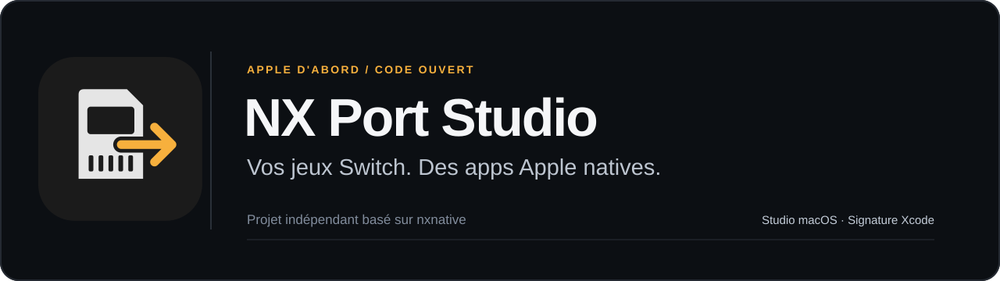
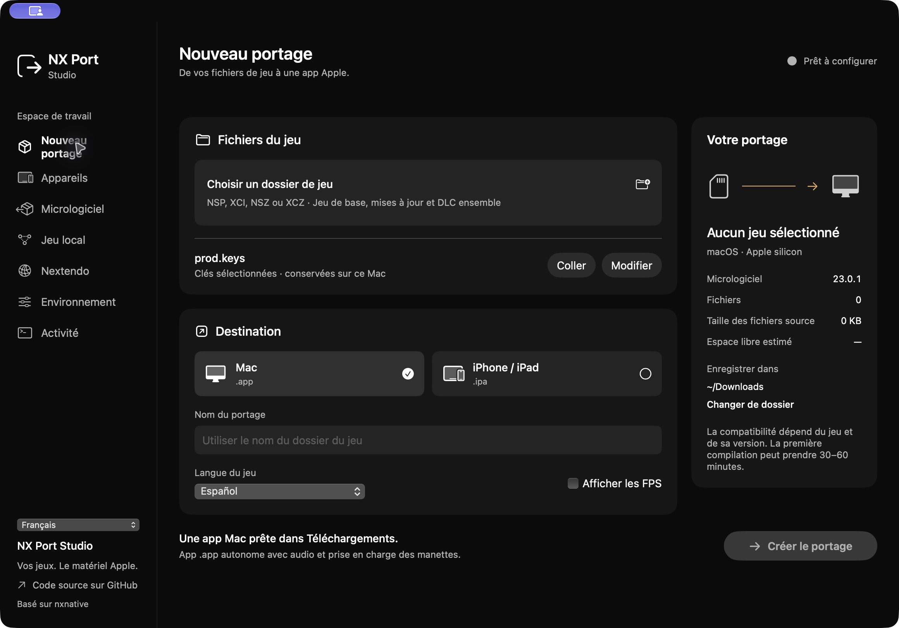
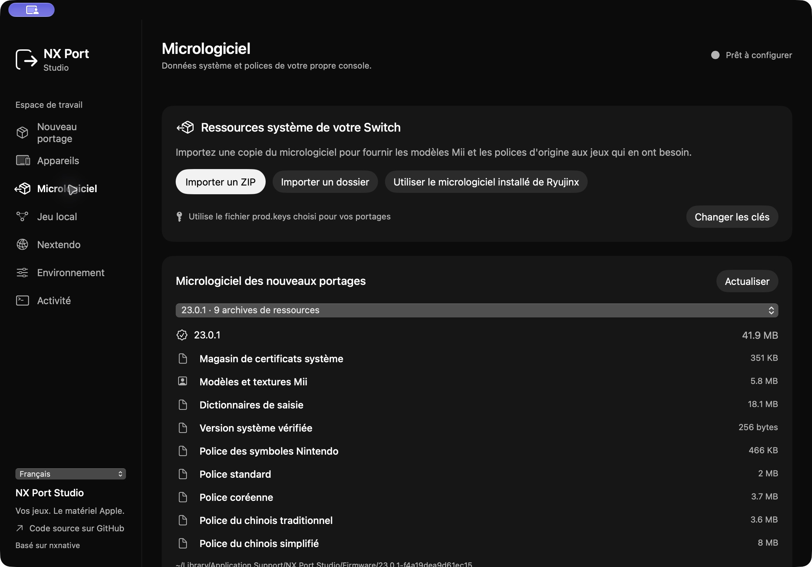
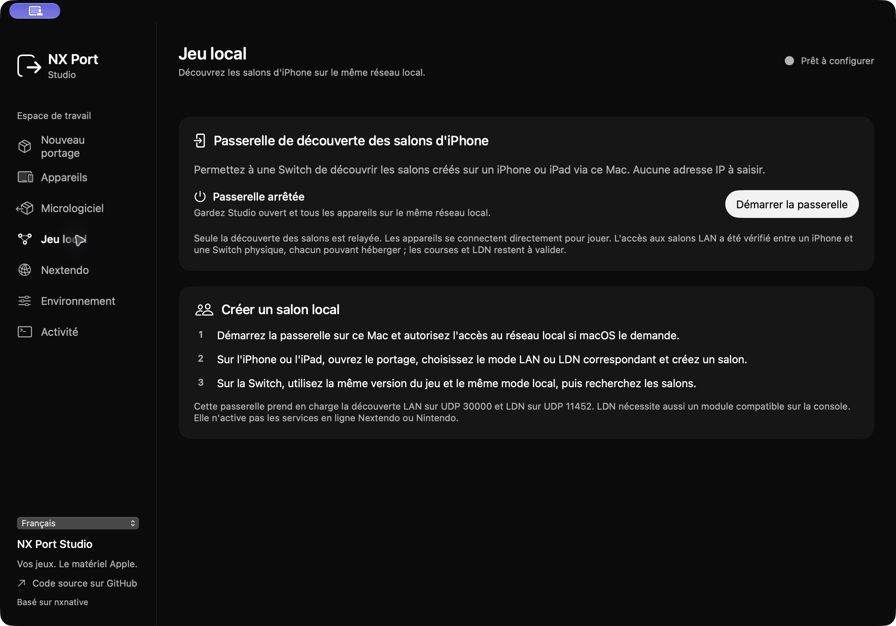

<a href="README.md">English</a> · <a href="README.es.md">Español</a> · <strong>Français</strong> · <a href="README.ja.md">日本語</a> · <a href="README.zh-Hans.md">简体中文</a>

**Je développe NX Port Studio pour transformer vos propres fichiers de jeux Nintendo Switch en applications natives pour les plateformes Apple.** L'espace de travail macOS rassemble la préparation des ressources, la compilation, les contrôles et la signature des ports iPhone/iPad avec Xcode.

Je m’appuie sur [nxnative de seedds](https://github.com/seedds/nxnative) pour ce projet indépendant. Je préserve les crédits des auteurs du moteur et leurs avis de copyright : [crédits](CREDITS.md), [licence MIT](LICENSE).

> **1.6.0 RC5 :** j’ai déplacé le rendu Mac dans le processus principal et mesuré 59,8–60 FPS sur un échantillon de Mario Kart 4.0.1 en plein écran. J’ai ajouté les calendriers de Splatoon 2 et une bibliothèque privée d’importation de Mii ; je dois encore valider le jeu en ligne et terminer l’éditeur du firmware d’origine. [Notes de version](docs/releases/1.6.0-rc.5.md).

## Dans l'application

L’importation reconnaît ZIP/7z, les sous-dossiers et les extensions en majuscules, avec une extraction limitée et une vérification d’intégrité. Les erreurs connues proposent des étapes de résolution dans les cinq langues de l’interface.

L'interface démarre en espagnol. Son sélecteur propose aussi l'anglais, le français, le japonais et le chinois simplifié. La langue de l'interface et celle du jeu se règlent séparément.

| Ressources du système | Découverte des salons locaux |
| :---: | :---: |
|  |  |

## Fonctionnalités

- Jeux de base, mises à jour et DLC dans un dossier par jeu, avec progression réelle et erreurs consultables.
- Exportations iOS signées par Xcode et vérifiées avant de signaler une réussite.
- Importation de vos ressources de firmware : modèles Mii, polices et certificats.
- J’ai ajouté une bibliothèque privée de Miis personnels dans **Micrologiciel → Importer des Miis**, distincte des modèles du micrologiciel. J’ai testé les formats, la persistance et l’intégration Mac/iOS avec des données synthétiques ; la vérification d’un Mii exporté de ma console dans un jeu reste à faire. Voir [formats et limites](docs/reference/services.md#personal-mii-imports-are-separate-from-firmware-model-archives).
- Mappage des contrôles, mouvement et vibrations selon les capacités du système et des manettes.
- Transport réseau natif, découverte LAN/LDN et intégration expérimentale de Nextendo.
- Configuration Nextendo depuis l’iPhone/iPad : navigateur du système, Trousseau de l’app et vérification des exigences du jeu et du service.

J’étends aussi le moteur : sockets Horizon, attentes HLE, vérification TLS, comptes et prise en charge des Joy-Con. La compatibilité dépend du jeu, de sa version et de l'appareil.

## État des essais

| Fonction | Résultat vérifié |
| --- | --- |
| LAN Mac ↔ Switch | J’ai terminé une course complète de Mario Kart 8 Deluxe 3.0.5 entre une version Mac antérieure et ma Switch physique. Avec le candidat actuel, j’ai vérifié la création d’un salon et l’ouverture des règles de l’hôte ; je n’ai pas répété cette course. |
| LAN iPhone ↔ Switch | J’ai vérifié la participation au salon dans les deux sens, avec chaque appareil comme hôte. Je n’ai pas encore vérifié de course complète sur iPhone. |
| LDN / mode sans fil | Le 31 octobre, j’ai testé Mario Kart 3.0.5 en LAN et LDN entre les ports natifs Mac/iOS et ma Switch physique. Cela concerne les ports précédents ; je dois encore revalider le nouveau moteur. Le pont LDN IP exige un module compatible. |
| Nextendo | J’ai vérifié le compte et **une manche réelle en arène de Smash 13.0.5 sur Mac**. J’ai explicitement autorisé le certificat exact du service. Ce résultat ne valide pas les parties rapides, les autres jeux ou le jeu en ligne sur iOS. |
| Android / Windows | Je les prévois après la stabilisation des plateformes Apple ; je n’ai aucune version disponible. ARM et x86 nécessitent des travaux distincts. |

Les ports activent les services de connexion automatiquement. Choisissez En ligne, Sans fil local ou LAN dans le jeu, sans sélectionner un autre mode ni redémarrer. La configuration Nextendo reste indépendante : l’absence d’identifiants en ligne ne bloque pas le jeu local. La désactivation du réseau et l’adresse de découverte facultative restent dans les réglages avancés.

Pour le LAN, utilisez la même version du jeu et le même réseau local. Ce réseau peut fonctionner sans accès Internet. Le pont LDN sur IP exige un module compatible sur la console ; le mode LAN d'un jeu suit son propre protocole.

Le 31 octobre 2026, j’ai vérifié la négociation TLS native de cinq services. Certains services NEX et d’authentification restent bloqués par leur chaîne de certificats. Le catalogue complet compte 58 entrées, 62 profils régionaux et 22 plans de correctifs vérifiés ; je dois encore valider les autres jeux natifs en ligne. La version Mario Kart 3.0.5 que j’ai testée ne satisfait pas l’exigence 4.0.1 du service. Consultez le [suivi complet](docs/nextendo-coverage.md).

## Démarrage

Il faut un Mac Apple silicon, macOS 14 ou ultérieur pour Studio, Xcode avec Swift 6 et vos propres fichiers de jeux et clés. Les ports iOS actuels ciblent iOS/iPadOS 26 et le matériel pris en charge. Certains jeux exigent une version plus récente de macOS/Metal.

Depuis le dépôt :

    cd macOS/NXPortStudio
    swift test
    swift run NXPortStudio

Dans Studio, préparez l'environnement, choisissez le dossier du jeu et prod.keys, puis sélectionnez Mac ou iPhone/iPad. Pour iOS, configurez votre équipe Xcode et un appareil associé. Un IPA est réussi seulement après signature et vérification ; les règles d'Apple sur les comptes et l'expiration s'appliquent.

Je conserve dans le dépôt les sources, les outils et mes captures de Studio. Les jeux, clés, firmwares, données de compte, sauvegardes et illustrations Nintendo restent hors du dépôt public.

Les ports Mac s’installent directement dans **Applications**. Le moteur temporaire, les fichiers extraits et les produits de compilation sont supprimés après la compilation, y compris en cas d’échec ou d’annulation. Les mises à jour vérifient la nouvelle app avant de remplacer le port du même jeu ; les sauvegardes et réglages sont conservés. Les projets iOS gardent leur flux de signature Xcode.

[Documentation complète en anglais](README.md) · [Feuille de route](ROADMAP.md) · [Contribuer](CONTRIBUTING.md)
