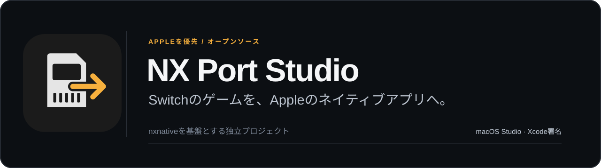
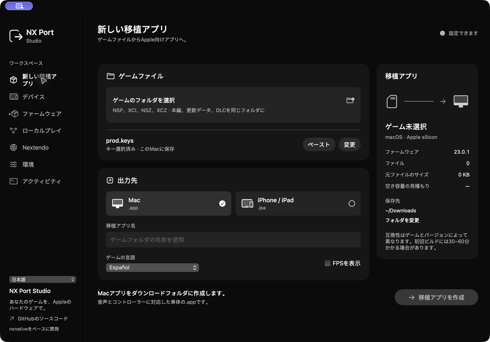
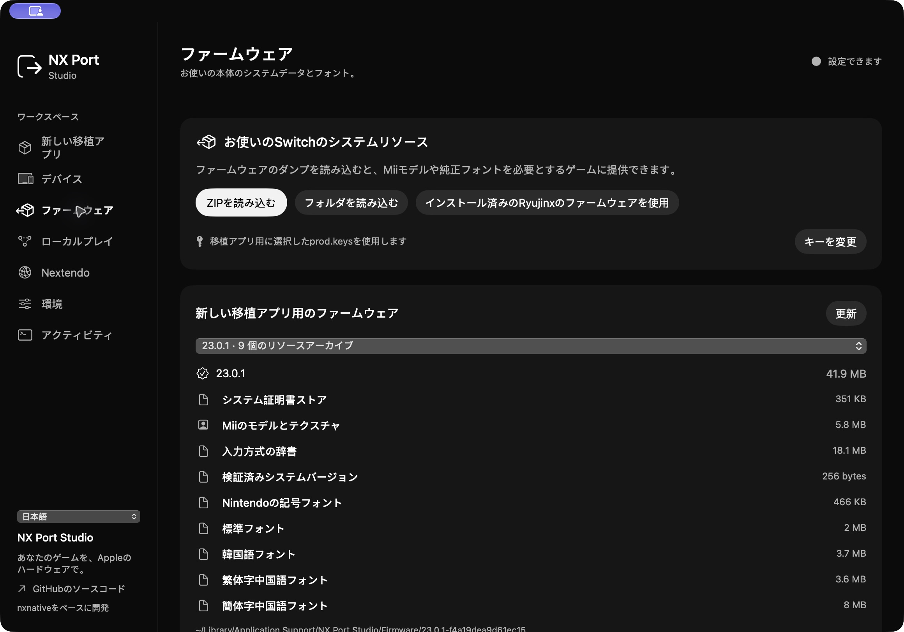
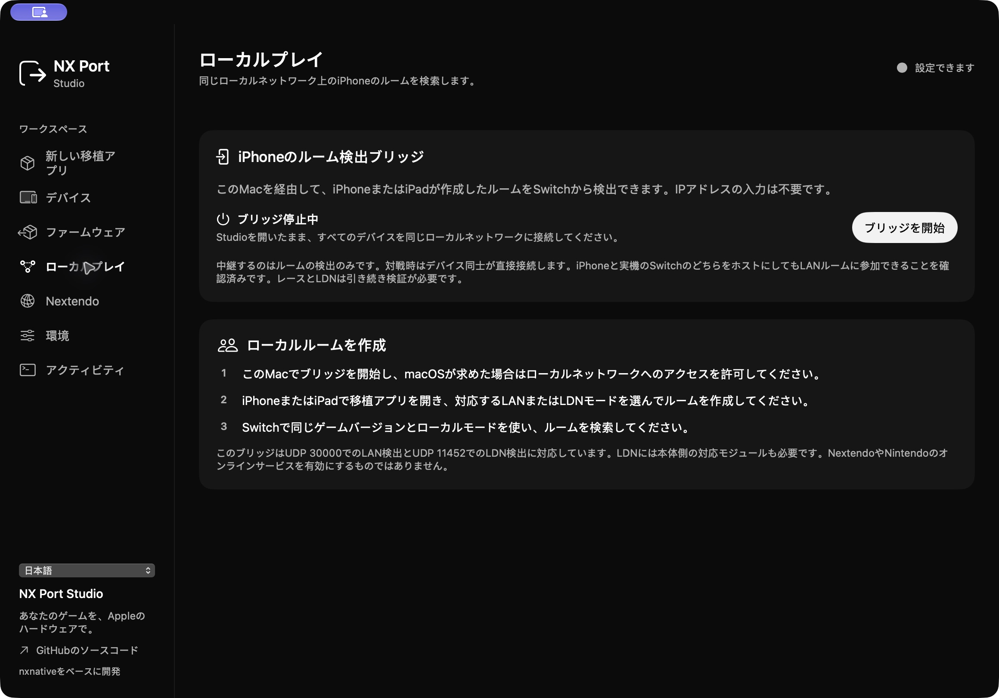

<a href="README.md">English</a> · <a href="README.es.md">Español</a> · <a href="README.fr.md">Français</a> · <strong>日本語</strong> · <a href="README.zh-Hans.md">简体中文</a>

**私は、自分で所有するNintendo SwitchのゲームファイルからApple向けのネイティブアプリを作成できるNX Port Studioを開発しています。** macOS用の作業環境で、リソースの準備、ビルド、コントローラー設定、XcodeによるiPhone/iPadアプリの署名を行えます。

私の独立プロジェクトは[seeddsのnxnative](https://github.com/seedds/nxnative)を基盤としています。元のエンジンの作者、MITライセンス、著作権表示を保持しています。[クレジット](CREDITS.md)と[ライセンス](LICENSE)をご確認ください。

> **1.6.0 RC7:** 私は再ビルドしたポートを検証し、描画エンジンが追跡するメモリへのソケット受信と、Smashの事前生成パイプラインの深度設定を修正しました。同じトレーニング場面で、ウィンドウ表示と全画面表示の両方が約60 FPSで動くことを測定しました。この候補版でのオンライン対戦はまだ確認できていません。[候補版のノートと検証範囲](docs/releases/1.6.0-rc.7.md)。

私はStudioと新しく作成するMac/iPhone移植版に**JKSV ZIPの読み込み・書き出し**を追加し、以前のセーブの保持、フォルダ表示、iOSのファイル共有に対応しています。[転送方法と検証範囲](docs/save-data.md)をご確認ください。

## Studioの画面

初期言語はスペイン語です。言語選択では英語、フランス語、日本語、簡体字中国語にも切り替えられます。アプリの表示言語とゲームの言語は別々に設定します。

| システムリソース | ローカルルームの検出 |
| :---: | :---: |
|  |  |

## 主な機能

- ZIP/7z、サブフォルダ、大文字の拡張子を認識し、展開範囲と整合性を検証します。既知のビルドエラーには5言語で対処手順を表示します。
- ゲームごとのフォルダーに本編、更新データ、DLCをまとめ、実際のビルド進行状況を確認できます。
- iOS向けの出力はXcodeで署名し、検証してから成功と判定します。
- 自分の本体から取得したMiiモデル、フォント、証明書などのリソースを読み込めます。
- 私は**ファームウェア → Miiを読み込む**に個人のMiiライブラリを追加しました。描画モデルとは別に保存します。合成データで形式、永続化、Mac/iOSへの組み込みを検証しましたが、自分の本体から書き出したMiiのゲーム内検証は未実施です。[形式と制限](docs/reference/services.md#personal-mii-imports-are-separate-from-firmware-model-archives)を参照してください。
- OSと機器が公開している機能に応じて、ボタン割り当て、モーション、振動を利用できます。
- ネイティブのネットワーク処理、LAN/LDNの検出、実験的なNextendo連携を実装しています。
- iPhone/iPad上でNextendoの連携、アプリのキーチェーンへの保存、ゲームとサービスの要件確認を行う画面を備えています。

私はビルド画面に加え、エンジンのHorizonソケット、HLEの待機処理、TLS検証、アカウント、Joy-Conの処理も拡張しています。動作可否はゲーム、更新バージョン、端末によって異なります。

## 検証状況

| 項目 | 確認できたこと |
| --- | --- |
| Mac ↔ SwitchのLAN | 私は以前のMario Kart 8 Deluxe 3.0.5と実機Switchでレースを完走し、別の旧3.0.5候補ではルーム作成も確認しました。過去の検証結果であり、現在の非公開4.0.1候補では再検証していません。 |
| iPhone ↔ SwitchのLAN | どちらをホストにした場合も、相手がルームに参加できることを私が確認しました。iPhoneでのレース完走はまだ確認していません。 |
| LDN・ローカル無線 | 10月31日、私はMac/iOSのネイティブ版と実機SwitchでMario Kart 3.0.5のLAN・LDNプレイを確認しました。同期前のポートでの結果であり、新エンジンは再検証が必要です。IP LDNには対応モジュールが必要です。 |
| Mario Kart 8 Deluxe 4.0.1 | 私は現在のRC7ランタイムを使ったMac版で、Nextendoの世界対戦を1レース完走し、エキサイトバイクのリザルトを確認しました。[ビルドと検証範囲](dm/games/0100152000022000/README.md#nextendo-race-validation-2026-11-02)。他のモードとiOSのオンライン対戦は未検証で、4.0.1での実機LAN/LDNも再検証していません。 |
| Smash 13.0.5・Nextendo | 私はアカウント連携と**Macの専用部屋での実際の1ラウンド**を確認し、サービスの特定証明書を明示的に許可しました。クイックプレイの不安定な回線エラーと、その後の観戦中の切断は未解決です。iOSのオンライン動作は未検証です。 |
| Splatoon 2 EUR 5.5.2・Nextendo | 11月2日、私はチュートリアルと広場を経て、**Macでオンラインロビーとナワバリバトルの待機列**に入りました。参加できる人数が少なかったため、対戦の検証は後日に回すことにしました。対戦完了、P2Pプレイ、LAN/LDN、iOSはまだ検証していません。 |
| Android・Windows | Apple向けの安定化後に取り組む予定です。私の配布ビルドはなく、ARMとx86にはそれぞれ開発が必要です。 |

ポートは接続サービスを自動で有効にします。別のモード選択や再起動は不要で、ゲーム内でオンライン、ローカル通信、LANを選べます。Nextendoの設定は独立しており、オンライン認証情報がなくてもローカルプレイを開始できます。ネットワーク無効化と任意の検出先アドレスは詳細設定に残ります。

LANではゲームのバージョンを揃え、同じローカルネットワークに接続してください。ネットワーク自体にインターネット接続は必須ではありません。LDNのIPブリッジには本体側の対応モジュールが必要で、ゲームに搭載されたLANモードとは別の仕組みです。

10月31日のTLS検証では、私は接続成功と未解決のNEXホスト名・デバイス認証チェーンの問題を記録しました。未解決の信頼性検証は引き続きエラーを返します。私は現在のMac版Mario Kart **4.0.1**で[上記の世界対戦1レース](dm/games/0100152000022000/README.md#nextendo-race-validation-2026-11-02)を完走しました。この経路の検証結果と、未解決の信頼性検証や未検証のモードは区別しています。Smashのクイックプレイと継続的な安定性も未解決です。Splatoon 2では検証済みのTLS接続2本でロビーと待機列に到達しましたが、対戦やP2Pプレイを確認した結果ではありません。[対応状況](docs/nextendo-coverage.md)では、この3タイトルの実測結果と、全58件のカタログ・62の地域別設定・22のパッチ計画を区別しています。

## はじめに

StudioにはApple silicon搭載Mac、macOS 14以降、Swift 6に対応したXcodeが必要です。ゲームファイルと本体のキーは自分で用意します。現在のiOSターゲットはiOS/iPadOS 26と対応ハードウェアです。ゲームによっては、さらに新しいmacOSやMetalが必要です。

リポジトリ内で次を実行します。

    cd macOS/NXPortStudio
    swift test
    swift run NXPortStudio

Studioで環境を準備し、ゲームのフォルダーとprod.keysを選び、MacまたはiPhone/iPadを指定します。iOSではXcodeのチームとペアリング済み端末を設定してください。IPAは署名と検証の完了後に成功となり、Appleのアカウントや有効期限の制約が適用されます。

私の公開リポジトリにはソース、ツール、Studioの画面を含めます。ゲーム、本体キー、ファームウェア、アカウント情報、セーブデータ、Nintendoの画像は含めません。

Mac向けのポートは**アプリケーション**に直接インストールされます。一時的なエンジン、展開データ、ビルド生成物は、成功時も失敗・キャンセル時も削除されます。更新時は新しいアプリを検証してから同じゲームのポートを置き換え、セーブデータと設定は保持します。iOSのXcode署名フローは引き続き利用できます。

[英語の詳細ガイド](README.md) · [ロードマップ](ROADMAP.md) · [開発への参加](CONTRIBUTING.md)
