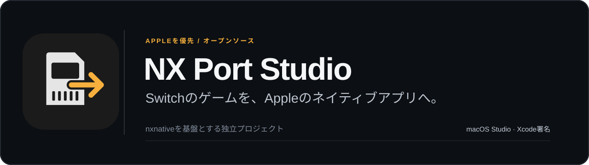
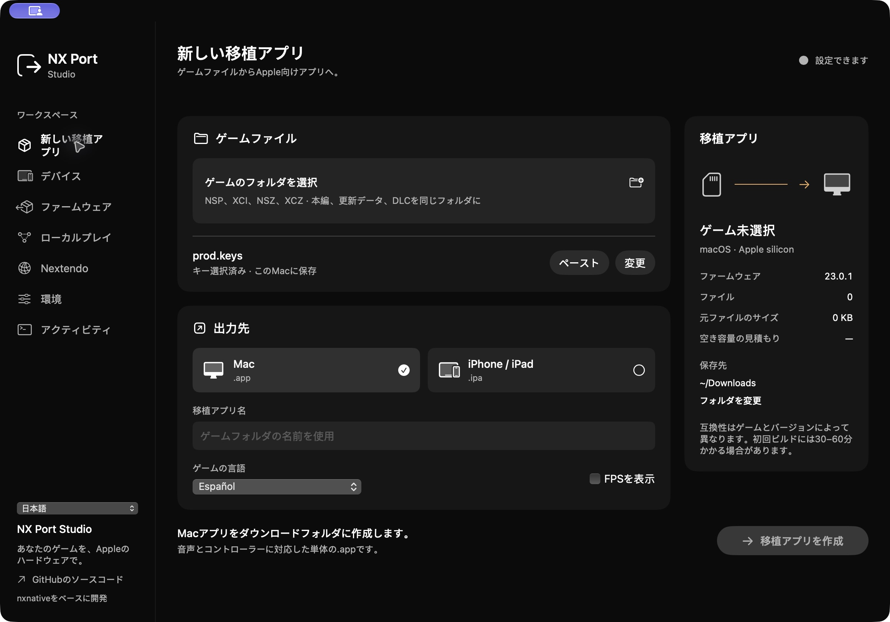
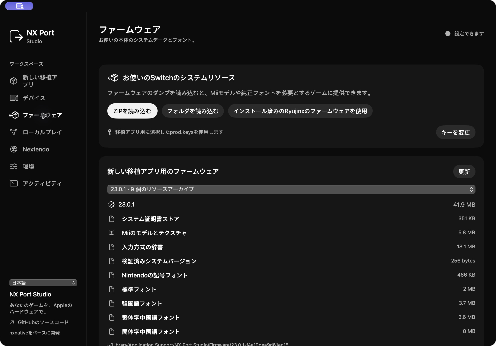
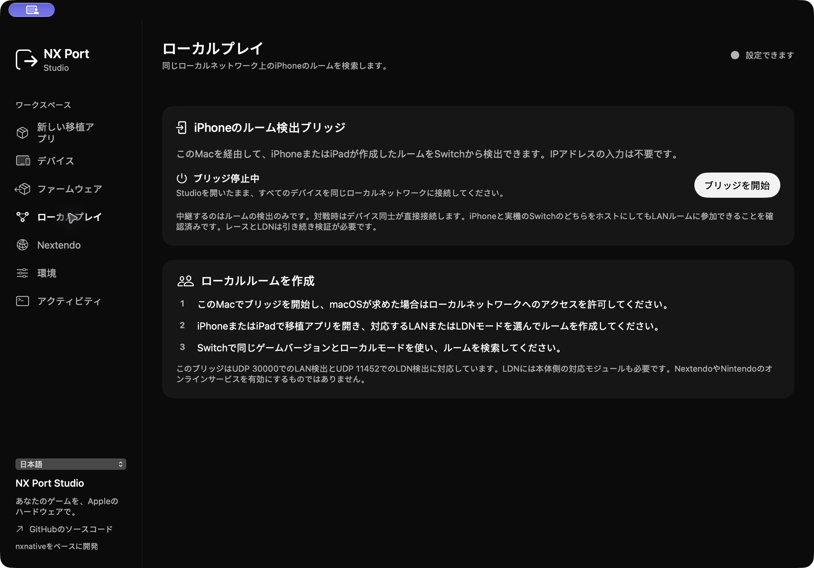

<a href="README.md">English</a> · <a href="README.es.md">Español</a> · <a href="README.fr.md">Français</a> · <strong>日本語</strong> · <a href="README.zh-Hans.md">简体中文</a>

**NX Port Studioは、自分で所有するNintendo Switchのゲームファイルから、Apple向けのネイティブアプリを作成するプロジェクトです。** macOS用の作業環境で、リソースの準備、ビルド、コントローラー設定、XcodeによるiPhone/iPadアプリの署名を行えます。

[seeddsのnxnative](https://github.com/seedds/nxnative)を基盤とする独立プロジェクトです。元のエンジンの作者、MITライセンス、著作権表示を保持しています。[クレジット](CREDITS.md)と[ライセンス](LICENSE)をご確認ください。

## Studioの画面

初期言語はスペイン語です。言語選択では英語、フランス語、日本語、簡体字中国語にも切り替えられます。アプリの表示言語とゲームの言語は別々に設定します。

| システムリソース | ローカルルームの検出 |
| :---: | :---: |
|  |  |

## 主な機能

- ゲームごとのフォルダーに本編、更新データ、DLCをまとめ、実際のビルド進行状況を確認できます。
- iOS向けの出力はXcodeで署名し、検証してから成功と判定します。
- 自分の本体から取得したMiiモデル、フォント、証明書などのリソースを読み込めます。
- OSと機器が公開している機能に応じて、ボタン割り当て、モーション、振動を利用できます。
- ネイティブのネットワーク処理、LAN/LDNの検出、実験的なNextendo連携を実装しています。

変更はビルド画面に加え、Horizonソケット、HLEの待機処理、TLS検証、アカウント、Joy-Conの処理にも及びます。動作可否はゲーム、更新バージョン、端末によって異なります。

## 検証状況

| 項目 | 確認できたこと |
| --- | --- |
| Mac ↔ SwitchのLAN | 以前のMacビルドでは、実機SwitchとMario Kart 8 Deluxe 3.0.5のレースを完走しました。現在の候補ビルドではルーム作成とホストのルール画面を確認しています。 |
| iPhone ↔ SwitchのLAN | どちらをホストにした場合も、相手がルームに参加できたとユーザーから報告されています。この組み合わせでのレース完走は未確認です。 |
| LDN・ローカル無線 | 現在の実機テストではルームが見つかりますが、参加と作成で接続エラーが出るため、原因を調査中です。 |
| Nextendo | OAuth、本人情報を照合したNEX資格情報の取得、署名付きカタログは検証済みです。ネイティブゲームのオンライン対戦は未検証です。 |
| Android・Windows | Apple向けの安定化後に取り組む予定です。配布ビルドはなく、ARMとx86にはそれぞれ開発が必要です。 |

LANではゲームのバージョンを揃え、同じローカルネットワークに接続してください。ネットワーク自体にインターネット接続は必須ではありません。LDNのIPブリッジには本体側の対応モジュールが必要で、ゲームに搭載されたLANモードとは別の仕組みです。

2026年10月28日時点では、Nextendoのゲーム用サービスの証明書と、手元のMario Kartのバージョンが障害になっています。手元のビルドは3.0.5ですが、署名付きカタログでは4.0.1が要求されています。アカウント連携だけでは解消しません。[詳細は英語版](README.md#current-game-service-blockers)を参照してください。

## はじめに

StudioにはApple silicon搭載Mac、macOS 14以降、Swift 6に対応したXcodeが必要です。ゲームファイルと本体のキーは自分で用意します。現在のiOSターゲットはiOS/iPadOS 26と対応ハードウェアです。ゲームによっては、さらに新しいmacOSやMetalが必要です。

リポジトリ内で次を実行します。

    cd macOS/NXPortStudio
    swift test
    swift run NXPortStudio

Studioで環境を準備し、ゲームのフォルダーとprod.keysを選び、MacまたはiPhone/iPadを指定します。iOSではXcodeのチームとペアリング済み端末を設定してください。IPAは署名と検証の完了後に成功となり、Appleのアカウントや有効期限の制約が適用されます。

公開リポジトリにはソース、ツール、Studioの画面を含めます。ゲーム、本体キー、ファームウェア、アカウント情報、セーブデータ、Nintendoの画像は含めません。

[英語の詳細ガイド](README.md) · [ロードマップ](ROADMAP.md) · [開発への参加](CONTRIBUTING.md)
