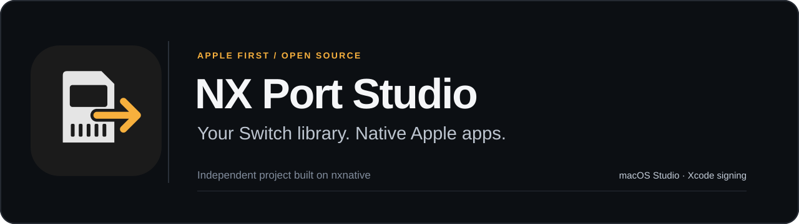
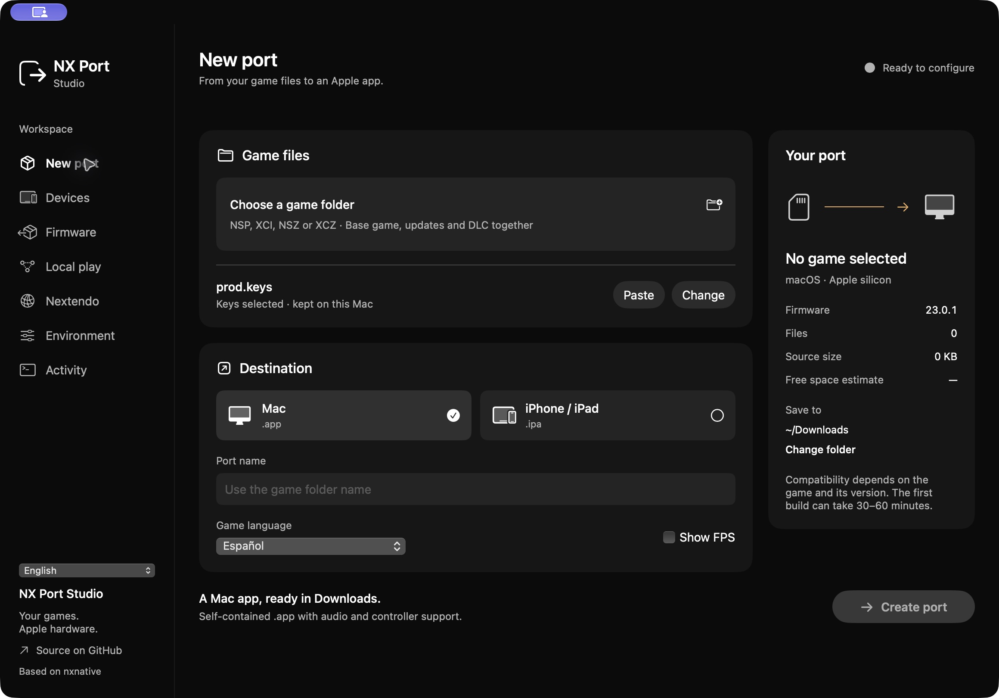
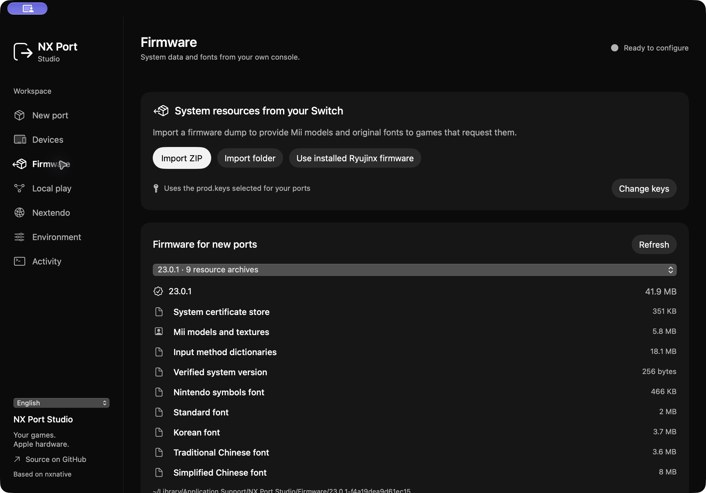
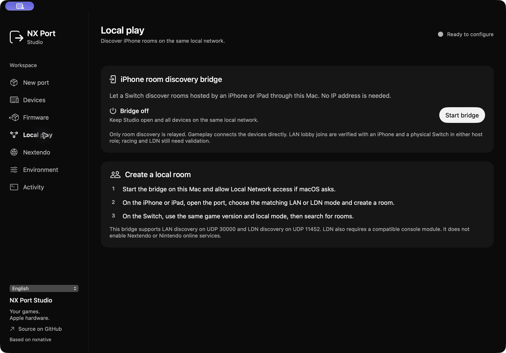

<p align="center">
  
</p>

<p align="center">
  <a href="#get-started">Get started</a> · <a href="#what-is-verified">Verified status</a> · <a href="ROADMAP.md">Roadmap</a> · <a href="CONTRIBUTING.md">Contribute</a> · <a href="CREDITS.md">Credits</a>
</p>

<p align="center"><strong>English</strong> · <a href="README.es.md">Español</a> · <a href="README.fr.md">Français</a> · <a href="README.ja.md">日本語</a> · <a href="README.zh-Hans.md">简体中文</a></p>

**I develop NX Port Studio as a macOS workspace for turning your own Nintendo Switch game files into native Apple apps.** Choose a game, prepare its tools and resources, then build a Mac app or an iPhone/iPad port signed through Xcode.

I build this independent project on [seedds/nxnative](https://github.com/seedds/nxnative). I preserve credit for the upstream native-execution engine and its authors, including their original MIT notice. See [Credits](CREDITS.md) and [License](LICENSE).

> **1.7.0:** Animal Crossing: New Horizons plays online through Nextendo on my Mac: I opened my island with a Dodo Code and a visitor came and went. Studio also becomes a launcher for installed Mac ports, with a home-menu Library and one Nextendo session shared by every port. [Release notes and test limits](docs/releases/1.7.0.md).

I include **JKSV save ZIP import/export** in Studio and newly built Mac/iPhone ports, with retained previous saves, folder access and Files sharing on iOS. See [save transfer and its validation limits](docs/save-data.md).

## Inside Studio

I captured the running macOS app in English.



| Versioned system resources | Local room discovery |
| :---: | :---: |
| [](docs/images/en/studio-firmware.jpg) | [](docs/images/en/studio-local-play.jpg) |

## One workspace, from input to app

- **A library of installed ports.** I added a **Library** page that works like a console home menu, with Studio's own look. It shows a row of large tiles for the Mac ports in Applications, the most recently played first, with the time, my Nextendo account and friends online at the top, and a row of round shortcuts below. Its friends screen lists my friends, best friends first, lets me accept or decline requests and send one with a friend code. I move with the arrow keys, play with Return, open a port's own settings window with Option-Return and switch to full screen with F. It shows which ports run and tells me when an older engine built one, so I know to rebuild it for the latest host fixes. Each port still runs, and signs in to Nextendo, without Studio ([how it works](docs/frontends.md#studios-library)).
- **Real build progress.** Choose one game's base files, updates and DLC; follow the engine's actual stages and actionable errors.
- **Flexible local imports.** ZIP/7z archives, nested folders and upper-case extensions are recognized, with bounded extraction and byte-verified reuse. Known build failures include recovery steps in all five interface languages.
- **Signed iOS exports.** Every iOS export goes through Xcode signing and profile verification. Optional installation follows a successful signed export.
- **Original system resources.** Import your own firmware data for Mii models, shared fonts and the certificate store, with version and content checks.
- **Personal Miis.** I added a private import library in **Firmware → Import Miis**, separate from the firmware models. I tested formats, persistence and Mac/iOS packaging with synthetic records; I still need to verify a personal console export in a game. See [formats and limits](docs/reference/services.md#personal-mii-imports-are-separate-from-firmware-model-archives).
- **Native controls.** Per-game controller settings, motion and vibration where the host platform and connected hardware expose them.
- **Connections from the game menu.** Online uses Nextendo, local wireless uses the LDN bridge and LAN uses native IP sockets. No launcher protocol selection or restart is required; I qualify each connection path separately.

The engine runs rewritten ARM64 game code on Apple silicon and implements the required host services and graphics translation. Compatibility depends on the exact game, update, profile and device. Creating an app does not by itself establish that the game is playable.

## Beyond the build UI

Alongside Studio, I extend the native runtime and integration paths:

- [Horizon socket transport](dm/host/hle_net_backend.c): explicit address/errno/flag translation, real TCP/UDP and safe descriptor close/reuse.
- [Blocking HLE entry](dm/host/entry.S): guest-register publication, native host stacks and pause/resume-aware waits instead of fabricated progress.
- [Apple TLS backend](dm/host/hle_ssl_apple.m): certificate/hostname verification and context-scoped trust, with original CertStore data supplied through the [firmware importer](dm/tools/nx_extract/FirmwareResources.cs).
- [Original LDN bridge](dm/host/hle_ldn.c): real discovery, session control, roster synchronization and lifecycle over the public protocol. I tested Mario Kart 3.0.5 LAN/LDN play across native Mac/iOS ports and my physical Switch.
- [Native account bridge](dm/host/hle_nextendo_apple.m), [social API](dm/host/hle_nextendo_social_apple.m) and [automatic service profiles](dm/tools/nextendo_services.py): real account/friend/presence data and per-title routing, with [complete catalog coverage and qualification](docs/nextendo-coverage.md). Scoped OAuth is not promoted into a game credential.
- [Signed provider game adapters](dm/tools/nextendo_patches.py): exact-build guarded IPS32 plans, compiled into separate Nextendo modules while Offline/LAN keep the original rewrite.
- [Controller mapping](dm/host/controls_map.h) and [Mac Joy-Con path](dm/host/joycon_mac.inc): Nintendo/Xbox layouts, public Apple controller APIs and a calibrated raw-device fallback on Mac. iOS remains limited to the capabilities its public APIs expose.

These mechanisms have different validation milestones. They do not establish that every game can play online.

## What is verified

| Area | Current evidence | Scope |
| --- | --- | --- |
| macOS Studio | I ran the build, configuration, process handling, resource import and Xcode signing tests successfully. | Apple silicon; the Studio interface requires macOS 14+. Individual games can require newer macOS/Metal features. |
| Mac ↔ Switch LAN | I **completed a full Mario Kart 8 Deluxe 3.0.5 race** between an earlier Mac build and my physical Switch. | Historical baseline for matching versions and the game's LAN mode. I have not repeated that race with the current candidate. |
| LDN bridge | On October 31, I tested Mario Kart 3.0.5 LAN and LDN play across native macOS/iOS ports and my physical Switch. I also ran the protocol and peer fixtures successfully. | Hardware result from the pre-sync ports; I still need a fresh game test with the new engine. IP LDN requires a compatible console module; built-in LAN is a separate path. |
| Mario Kart 8 Deluxe 4.0.1 | I completed **one Worldwide Nextendo race on Mac**, through the Excitebike Arena results, with my current RC7 host. [Exact build and limits](dm/games/0100152000022000/README.md#nextendo-race-validation-2026-11-02). | Other modes and iOS online remain unqualified. I have not repeated physical LAN/LDN with 4.0.1; the 3.0.5 results remain historical. |
| Smash 13.0.5 — Nextendo | I verified account integration and **one real arena round on Mac**. | I explicitly approved the service's exact certificate. Quickplay's unstable-network rejection and a later spectator disconnect remain open; iOS online is unqualified. |
| Splatoon 2 EUR 5.5.2 — Nextendo | On November 2, I entered the **online lobby and Territorial matchmaking queue on Mac**, after completing the tutorial and reaching the plaza. | I postponed the match test because too few players were available. I have not qualified a completed match, peer-to-peer gameplay, LAN/LDN or iOS for this title. |
| Splatoon 3 12.0.0 — Nextendo | On November 21, the plaza, the lobby and its practice area **rendered on Mac as they do on my Switch**, and I **completed an online Salmon Run shift with other players on Mac**. [Exact build and limits](dm/games/0100C2500FC20000/README.md#mac-acceptance-on-november-21-2026). | One Salmon Run shift with RC9's code. Turf War and Anarchy matches, LAN/LDN and iOS remain unqualified. |
| iPhone/iPad | I checked that a signed Mario Kart 3.0.5 build joins LAN lobbies with my physical Switch, with each device as host. | I verified lobby entry; I have not verified a completed race on iPhone. Device, signing and platform restrictions still apply. |
| Android / Windows | I plan these after the Apple baseline is stable. | I have no builds or compatibility results yet; ARM and x86 need separate architecture work. |

## Games with online and local play

These are the Switch games whose network modes I have tested in NX Port Studio ports. Each game chooses Online, Local wireless or LAN from its own menus; Nextendo needs a linked account. A ✅ means I completed that step in the game; 🟡 means I reached the lobby or queue but have not finished a match; — means not tested yet.

| Game | Version | Nextendo online | LAN | Local wireless (LDN) | Platform |
| --- | --- | --- | --- | --- | --- |
| [Mario Kart 8 Deluxe](dm/games/0100152000022000/README.md) | 4.0.1 (LAN/LDN on 3.0.5) | ✅ One complete Worldwide race | ✅ A complete race between Mac and my Switch; iPhone lobbies in both host roles | ✅ Sessions across Mac, iPhone and my Switch (the console needs a compatible LDN module) | Mac; iPhone for local lobbies |
| [Super Smash Bros. Ultimate](dm/games/01006A800016E000/README.md) | 13.0.5 | ✅ One arena round against a remote player | — | — | Mac |
| [Splatoon 2](dm/games/0100F8F0000A2000/README.md) (Europe) | 5.5.2 | 🟡 Lobby and Turf War queue | — | — | Mac |
| [Splatoon 3](dm/games/0100C2500FC20000/README.md) | 12.0.0 | ✅ One Salmon Run shift with other players | — | — | Mac |
| [Animal Crossing: New Horizons](dm/games/01006F8002326000/README.md) | 3.0.3 | ✅ A visitor came to my island through a Dodo Code | — | — | Mac |

Known limits:
- **Smash:** Quickplay rejects the connection as unstable, and a later spectating session disconnected.
- **Splatoon 2 and 3:** the provider's matchmaking needs other players searching the same mode at the same time. Splatoon 3's server keeps the full count (8 for Turf War, 4 for Salmon Run) for 45 seconds and then lowers it, never below half (4 and 2). With few people online the queue can wait indefinitely, so Salmon Run with a friend is the quickest way to reach a match.
- **Animal Crossing:** I have hosted one visitor; I have not yet visited another island.
- **All five:** I have not qualified iPhone online play. Mario Kart's LAN/LDN results are from 3.0.5, and I have not repeated them on 4.0.1.

Each game note has the exact build, dates and open issues.

## Get started

### Requirements

- An Apple silicon Mac with macOS 14 or later for Studio, plus [Xcode 27.2](https://developer.apple.com/xcode/) with Swift 6. The engine validates that version’s Metal compiler against its translation lock. The engine or an individual game may need newer graphics tooling.
- Your own game files and console keys. Matching updates and DLC belong in the same game's input folder.
- For iPhone/iPad exports: an eligible physical device, Xcode account/team configuration, pairing, trust and Developer Mode. Current engine targets use iOS/iPadOS 26 and supported A17 Pro/M-series hardware; consult the per-game notes.

### Build Studio from source

From a checkout containing the Studio and engine sources:

```sh
cd macOS/NXPortStudio
swift test
swift run NXPortStudio
```

Create a local app bundle:

```sh
./scripts/package_app.sh "/path/to/NX Port Studio.app"
```

The package script refuses to overwrite an existing destination. Its default local ad-hoc signature is for the **Mac Studio app**; public notarized distribution is a separate release step. **Game IPAs use Xcode development signing**, with Apple's account, device and expiration rules.

### Create a port

1. Open **Environment** and prepare the tools the engine reports as required.
2. Select one game's folder and your `prod.keys` in **New port**.
3. Optionally import original system resources in **Firmware** and choose the catalog for new ports.
4. Choose **Mac** or **iPhone / iPad**. For iOS, select a paired eligible device and enter your Xcode development Team ID.
5. Create the port. Mac builds install directly in **Applications** and remove their temporary engine, extraction and build files. Updates replace only a verified port of the same game, and the port appears in **Library**. An iOS build is successful only after signing and IPA verification; **Install when finished** controls installation, not whether the export is signed.

The interface starts in Spanish. Choose English, French, Japanese or Simplified Chinese in the sidebar or Language menu. Interface and game languages are independent. Technical tool output retains its original language. Mac builds retain only the installed app; saves and runtime settings live in Application Support. iOS projects and extracted files remain beside the game for Xcode signing; IPA exports default to Downloads.

## Network modes have different requirements

Ports start with automatic connection services. Choose Online, Local wireless or LAN inside the game. Nextendo setup is available independently; missing online credentials do not block local play. Network disabling and a discovery peer override remain optional advanced settings.

**LAN** uses a game's own LAN mode and real IP sockets. Use matching game versions and the same network. My completed Mario Kart 3.0.5 race and the earlier candidate's [local room creation](dm/games/0100152000022000/README.md#local-network-validation) are historical results. I now have a private 4.0.1 Mac candidate; I have not repeated the physical LAN/LDN qualification with it.

**LDN** bridges local-wireless service discovery and membership over IP. It needs a compatible peer/module and a matching game. Passing peer fixtures is not a substitute for testing a physical console.

Some games also require a local play-history identity during room setup. Import your own firmware in Studio and select it before building the port. The importer can extract that private resource from a recognized friends module; I validated resources from firmware 23.0.1. [The implementation and its limits](docs/reference/services.md#local-play-history-identity-required-after-network-creation) are documented separately from online accounts.

**Nextendo** adds account authorization and signed service policies. Studio uses your own registered application's client ID, saved locally, and keeps account credentials in the Mac's Keychain. Scoped OAuth access is not automatically a NEX game credential. An explicit request can obtain an identity-checked NEX credential; I verified that account step. A listed or enabled server, an accepted version and a saved credential each describe a requirement; none proves a working native online match. Check the signed catalog in the app for current version policy. A packed Mac game can also link or renew the account itself: reopen it holding Option and choose **Sign in with Nextendo** under **Online play** in its settings window. It uses the same Keychain item as Studio, so an account linked in either place serves both. On the Mac, **Keep Nextendo connected** on Studio's Nextendo page runs a small background agent. With it, every installed Mac game uses one session without asking for Keychain access, and a sign-out reaches open games. Its **Friends** panel shows who is online and lets me answer friend requests, and it can notify when a friend comes online. I tested these with fixtures only, not yet with a game ([design and limits](docs/nextendo-agent.md)).

The port also includes **Nextendo setup on iPhone/iPad**: authorize in the system browser, keep the account in the app's Keychain, refresh the signed catalog and inspect game-version/service requirements before launch. I covered these device-side flows with fixtures; physical browser authorization remains part of my ongoing validation. Account setup does not establish a working native online match.

On iOS, the runtime implements automatic unicast discovery on an eligible, bounded IPv4 local subnet when broadcast/multicast access is unavailable. The advanced peer address is optional. I checked LAN lobby entry in both host roles with my physical Switch; I have not verified a complete race on iPhone.

For rooms hosted on iPhone/iPad, Studio's **Local play → Start bridge** enables an optional [local discovery relay](dm/net/lan_relay.c) on the Mac. Keep Studio open on the same network. The bridge relays supported LAN/LDN room discovery; gameplay connects peers directly. It starts off, shows real traffic/error state and does not require an account or a manually entered IP address. **On October 31, I tested Mario Kart 3.0.5 LAN and LDN play across native Mac/iOS ports and my physical Switch, before the engine synchronization.** This does not qualify every game, host pairing or the newly synchronized engine.

### Current game-service blockers

My October 31 TLS probes recorded both successful scoped-CA handshakes and unresolved NEX hostname/device-authentication chain failures. I preserve that evidence and keep unresolved trust checks failing. My current private Mario Kart **4.0.1** Mac port completed the [single Worldwide race recorded above](dm/games/0100152000022000/README.md#nextendo-race-validation-2026-11-02); I keep that tested route separate from unresolved trust checks and untested modes. For Smash, Quickplay and later-session stability remain open. For Splatoon 2, two verified TLS connections reached the lobby and queue, but I deferred the match test; that does not qualify peer-to-peer play. The [coverage inventory](docs/nextendo-coverage.md) separates these three titles' actual results from all 58 catalog entries, 62 regional service profiles and 22 exact-build patch plans.

## What belongs in this repository

I keep source, original project artwork, profiles, tooling, documentation and preserved dependency licenses here. Games, decrypted game assets, console keys, firmware archives, account credentials and personal save data do not. Nintendo screenshots, covers, artwork, game icons and original SDK files are excluded from this public repository. Validation results are described in text.

See [Contributing](CONTRIBUTING.md) for useful bug reports and validation evidence, and [Roadmap](ROADMAP.md) for planned work. This project is not affiliated with Nintendo, Apple, Nextendo or the upstream authors; using an upstream engine or a service does not imply their endorsement.
