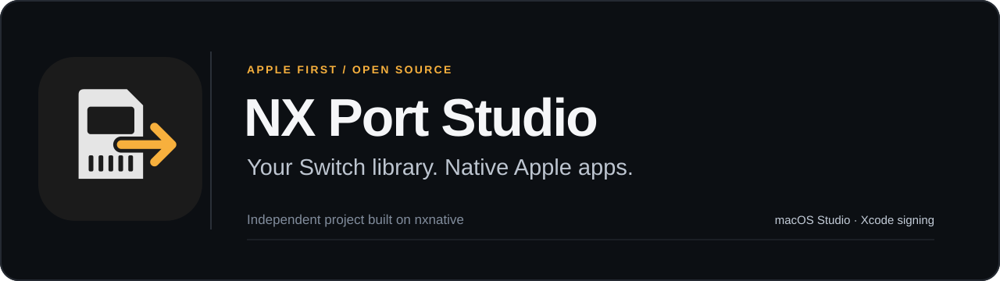
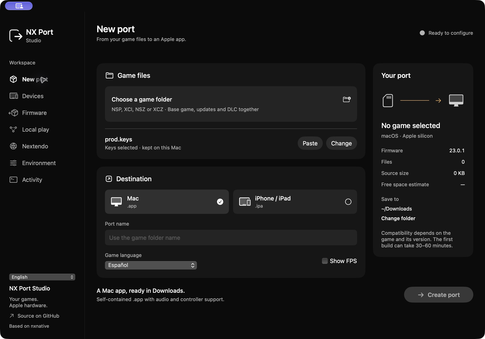
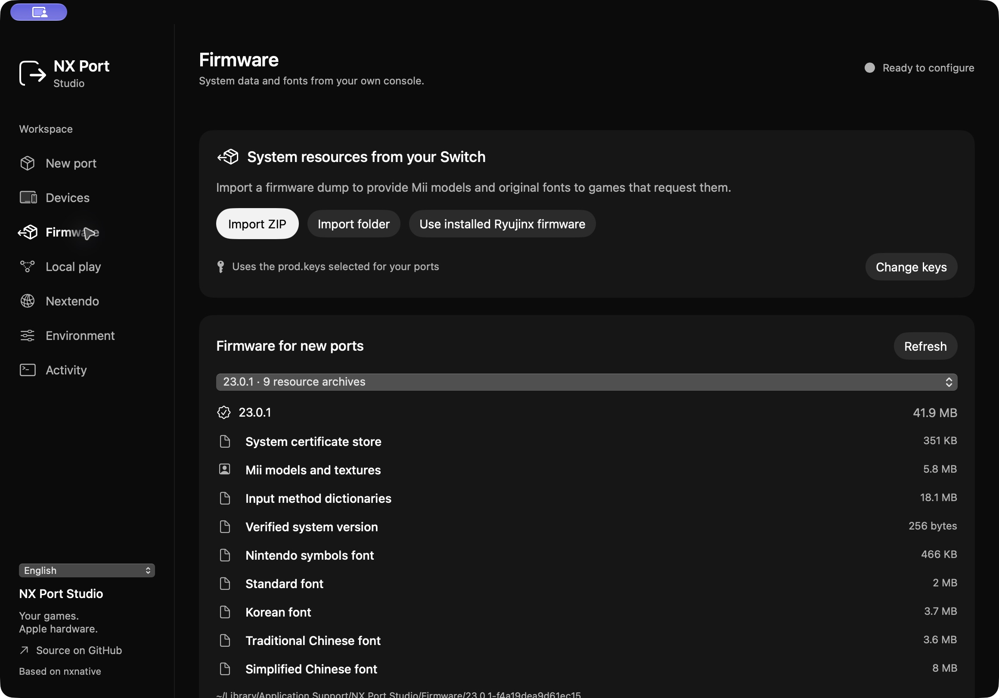
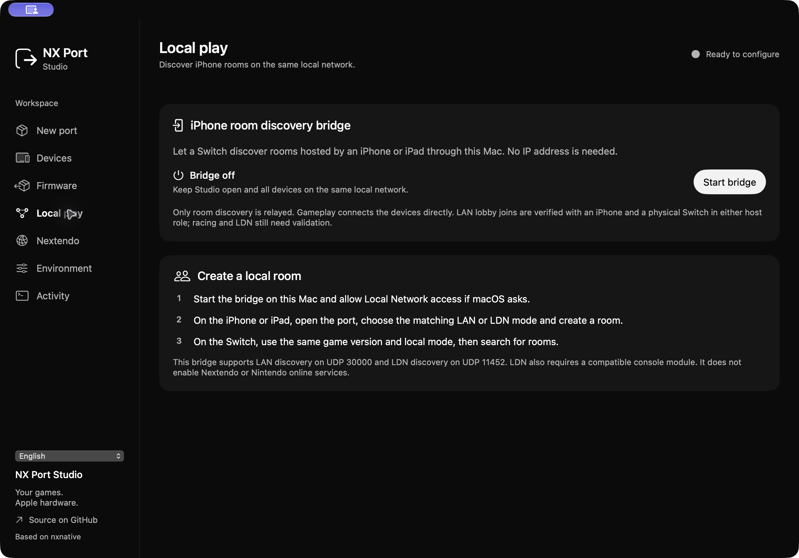

<p align="center">
  
</p>

<p align="center">
  <a href="#get-started">Get started</a> · <a href="#what-is-verified">Verified status</a> · <a href="ROADMAP.md">Roadmap</a> · <a href="CONTRIBUTING.md">Contribute</a> · <a href="CREDITS.md">Credits</a>
</p>

<p align="center"><strong>English</strong> · <a href="README.es.md">Español</a> · <a href="README.fr.md">Français</a> · <a href="README.ja.md">日本語</a> · <a href="README.zh-Hans.md">简体中文</a></p>

**NX Port Studio is a macOS workspace for turning your own Nintendo Switch game files into native Apple apps.** Choose a game, prepare its tools and resources, then build a Mac app or an iPhone/iPad port signed through Xcode.

This is an independent project built on [seedds/nxnative](https://github.com/seedds/nxnative). The upstream native-execution engine, its authors and their original MIT notice remain credited and preserved. See [Credits](CREDITS.md) and [License](LICENSE).

## Inside Studio

Captured from the running macOS app in English.



| Versioned system resources | Local room discovery |
| :---: | :---: |
| [](docs/images/en/studio-firmware.jpg) | [](docs/images/en/studio-local-play.jpg) |

## One workspace, from input to app

- **Real build progress.** Choose one game's base files, updates and DLC; follow the engine's actual stages and actionable errors.
- **Signed iOS exports.** Every iOS export goes through Xcode signing and profile verification. Optional installation follows a successful signed export.
- **Original system resources.** Import your own firmware data for Mii models, shared fonts and the certificate store, with version and content checks.
- **Native controls.** Per-game controller settings, motion and vibration where the host platform and connected hardware expose them.
- **Explicit networking.** Keep ordinary LAN, LDN bridging and Nextendo service integration distinct, with evidence for each path.

The engine runs rewritten ARM64 game code on Apple silicon and implements the required host services and graphics translation. Compatibility depends on the exact game, update, profile and device. Creating an app does not by itself establish that the game is playable.

## Beyond the build UI

This project also extends the native runtime and integration paths:

- [Horizon socket transport](dm/host/hle_net_backend.c): explicit address/errno/flag translation, real TCP/UDP and safe descriptor close/reuse.
- [Blocking HLE entry](dm/host/entry.S): guest-register publication, native host stacks and pause/resume-aware waits instead of fabricated progress.
- [Apple TLS backend](dm/host/hle_ssl_apple.m): certificate/hostname verification and context-scoped trust, with original CertStore data supplied through the [firmware importer](dm/tools/nx_extract/FirmwareResources.cs).
- [Original LDN bridge](dm/host/hle_ldn.c): real discovery, session control, roster synchronization and lifecycle over the public protocol, with physical interoperability still to be checked.
- [Native account bridge](dm/host/hle_nextendo_apple.m) and [service routes](dm/host/hle_nextendo_routes.c): explicit credential/identity handling and routing; scoped OAuth is not promoted into a game credential.
- [Controller mapping](dm/host/controls_map.h) and [Mac Joy-Con path](dm/host/joycon_mac.inc): Nintendo/Xbox layouts, public Apple controller APIs and a calibrated raw-device fallback on Mac. iOS remains limited to the capabilities its public APIs expose.

These mechanisms have different validation milestones. They do not establish that every game can play online.

## What is verified

| Area | Current evidence | Scope |
| --- | --- | --- |
| macOS Studio | Build, configuration, process handling, resource import and Xcode signing tests pass. | Apple silicon; the Studio interface requires macOS 14+. Individual games can require newer macOS/Metal features. |
| Mac ↔ Switch LAN | An earlier tested Mac build **completed a full Mario Kart 8 Deluxe 3.0.5 race** with a physical Switch. | Historical baseline for matching versions and the game's LAN mode. The current candidate has not repeated that race. |
| LDN bridge | Original `ldn_mitm`-compatible implementation; protocol, malformed-input, membership and two-process peer tests pass. | Physical scanning finds rooms, but joining and creating currently fail with connection errors. Diagnosis is ongoing. LDN is separate from a game's IP LAN mode. |
| Nextendo | Own-application OAuth, identity-checked NEX credential acquisition, Keychain roundtrip and signed game/version catalog integration are verified. | Scoped OAuth and a NEX credential remain different states. **A native NEX online match has not been validated.** |
| iPhone/iPad | A signed Mario Kart 3.0.5 build has joined LAN lobbies with a physical Switch in both host roles, confirmed by the user. | Lobby entry is verified; a completed race remains unverified. Device, signing and platform restrictions still apply. |
| Android / Windows | Planned after the Apple baseline is stable. | No builds or compatibility claims yet; ARM and x86 need separate architecture work. |

## Get started

### Requirements

- An Apple silicon Mac with macOS 14 or later for Studio, plus Xcode with Swift 6. The engine or an individual game may need newer graphics tooling.
- Your own game files and console keys. Matching updates and DLC belong in the same game's input folder.
- For iPhone/iPad exports: an eligible physical device, Xcode account/team configuration, pairing, trust and Developer Mode. Current engine targets use iOS/iPadOS 26 and supported A17 Pro/M-series hardware; consult the per-game notes.

### Build Studio from source

From a checkout containing the Studio and engine sources:

```sh
cd macOS/NXPortStudio
swift test
swift run NXPortStudio
```

Create a local app bundle:

```sh
./scripts/package_app.sh "/path/to/NX Port Studio.app"
```

The package script refuses to overwrite an existing destination. Its default local ad-hoc signature is for the **Mac Studio app**; public notarized distribution is a separate release step. **Game IPAs use Xcode development signing**, with Apple's account, device and expiration rules.

### Create a port

1. Open **Environment** and prepare the tools the engine reports as required.
2. Select one game's folder and your `prod.keys` in **New port**.
3. Optionally import original system resources in **Firmware** and choose the catalog for new ports.
4. Choose **Mac** or **iPhone / iPad**. For iOS, select a paired eligible device and enter your Xcode development Team ID.
5. Create the port. An iOS build is successful only after signing and IPA verification; **Install when finished** controls installation, not whether the export is signed.

The interface starts in Spanish. Choose English, French, Japanese or Simplified Chinese in the sidebar or Language menu. Interface and game languages are independent. Technical tool output retains its original language. Build products and extracted game data stay beside the selected game; exports default to Downloads.

## Network modes have different requirements

**LAN** uses a game's own LAN mode and real IP sockets. Use matching game versions and the same network. The earlier completed Mario Kart race above is the physical interoperability baseline; it does not certify a later runtime candidate. The current 3.0.5 Mac candidate can [create a local LAN room](dm/games/0100152000022000/README.md#local-network-validation), reaching the host lobby and rules. An external peer joining and a newly completed race remain unvalidated for that candidate.

**LDN** bridges local-wireless service discovery and membership over IP. It needs a compatible peer/module and a matching game. Passing peer fixtures is not a substitute for testing a physical console.

**Nextendo** adds account authorization and signed service policies. Studio uses your own registered application's client ID, saved locally, and keeps account credentials in the Mac's Keychain. Scoped OAuth access is not automatically a NEX game credential. An explicit request can obtain an identity-checked NEX credential; that account step has been verified. A listed or enabled server, an accepted version and a saved credential each describe a requirement; none proves a working native online match. Check the signed catalog in the app for current version policy.

On iOS, the runtime implements automatic unicast discovery on an eligible, bounded IPv4 local subnet when broadcast/multicast access is unavailable. The advanced peer address is optional. The user confirmed LAN lobby entry in both host roles with a physical Switch; a complete race remains unverified.

For rooms hosted on iPhone/iPad, Studio's **Local play → Start bridge** enables an optional [local discovery relay](dm/net/lan_relay.c) on the Mac. Keep Studio open on the same network. The bridge relays supported LAN/LDN room discovery; gameplay connects peers directly. It starts off, shows real traffic/error state and does not require an account or a manually entered IP address. **LAN lobby entry in both host roles is user-confirmed. Racing and physical LDN interoperability remain unverified.**

### Current game-service blockers

The currently tested native Nextendo game-service paths remain blocked by certificate issues: five server certificates with ten-year validity fail Apple's native trust policy, and the configured Mario Kart authentication endpoint lacks a validated certificate for its hostname. Verification remains enabled. The available Mario Kart 8 Deluxe **3.0.5** build also falls outside the signed catalog's current **4.0.1** requirement. These are separate from the successful account-credential step. This is a dated preflight result (2026-10-28); refresh the signed catalog for current version policy.

## What belongs in this repository

Source, original project artwork, profiles, tooling, documentation and preserved dependency licenses belong here. Games, decrypted game assets, console keys, firmware archives, account credentials and personal save data do not. Nintendo screenshots, covers, artwork, game icons and original SDK files are excluded from this public repository. Validation results are described in text.

See [Contributing](CONTRIBUTING.md) for useful bug reports and validation evidence, and [Roadmap](ROADMAP.md) for planned work. This project is not affiliated with Nintendo, Apple, Nextendo or the upstream authors; using an upstream engine or a service does not imply their endorsement.
