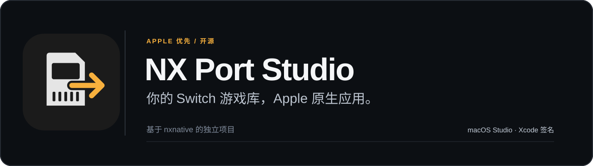
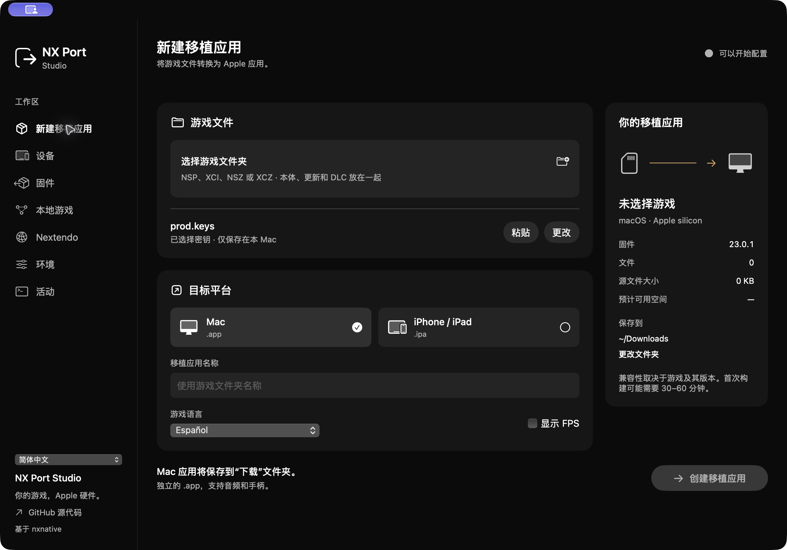
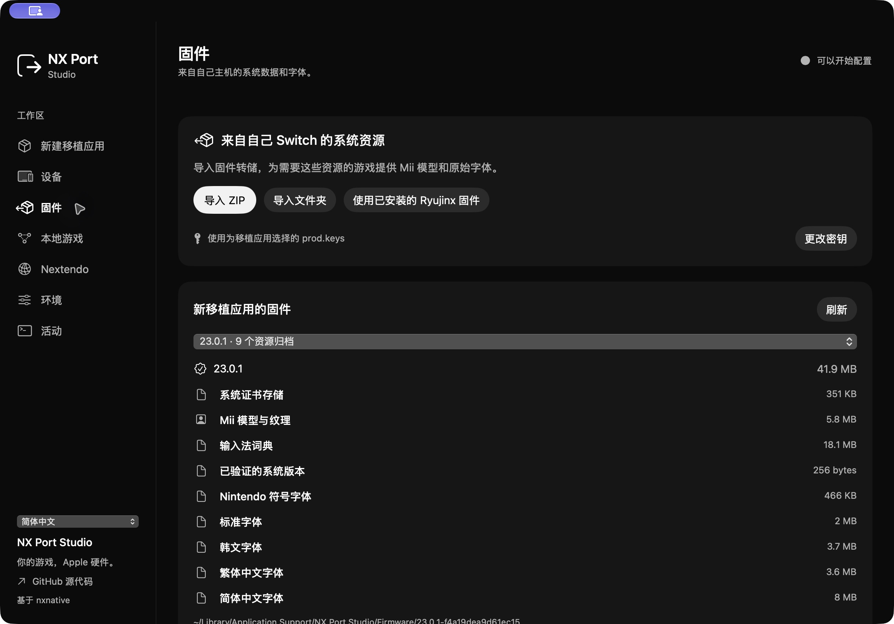
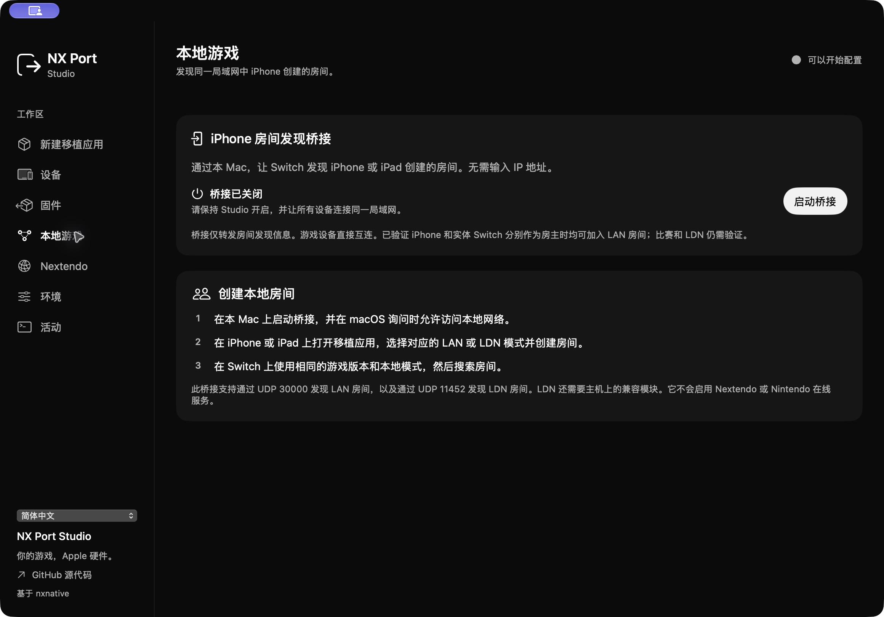

<a href="README.md">English</a> · <a href="README.es.md">Español</a> · <a href="README.fr.md">Français</a> · <a href="README.ja.md">日本語</a> · <strong>简体中文</strong>

**我开发 NX Port Studio，让你能把自己拥有的 Nintendo Switch 游戏文件制作成 Apple 平台的原生应用。** macOS 工作台整合了资源准备、构建、控制器设置，以及通过 Xcode 为 iPhone/iPad 应用签名的流程。

我的独立项目基于 [seedds/nxnative](https://github.com/seedds/nxnative)，我保留了原引擎作者署名、MIT 许可和版权声明。请参阅[致谢](CREDITS.md)与[许可证](LICENSE)。

> **1.7.0：**我的 Mac 上《集合啦！动物森友会》已可通过 Nextendo 在线游玩：我用 Dodo 代码开放了岛屿，一位访客来过又离开。Studio 还成为已安装 Mac 移植版的启动器，带有主菜单式的游戏库，所有移植版共用一个 Nextendo 会话。[发行说明与测试限制](docs/releases/1.7.0.md)。

我在Studio与新构建的Mac/iPhone移植版中加入了**JKSV ZIP存档导入和导出**，保留旧存档，提供文件夹浏览与iOS文件共享。请参阅[存档传输与验证范围](docs/save-data.md)。

## 应用截图

界面默认使用西班牙语，也可切换为英语、法语、日语或简体中文。界面语言与游戏语言分别设置。

| 系统资源 | 本地房间发现 |
| :---: | :---: |
|  |  |

## 主要功能

- 识别 ZIP/7z、子文件夹及大写扩展名，限制解压范围并验证完整性。已知构建错误会以五种界面语言提供处理步骤。
- 每个游戏使用独立文件夹，集中管理本体、更新与 DLC，并显示实际构建进度和错误。
- iOS 导出必须经过 Xcode 签名和验证，之后才能报告成功。
- 导入自己主机中的 Mii 模型、字体、证书等系统资源。
- 我在**固件 → 导入 Mii**中添加了私人的个人 Mii 库，与固件模型分开保存。我已用合成记录验证格式、持久化及 Mac/iOS 打包；仍需在游戏中验证从自己主机导出的 Mii。参阅[格式与限制](docs/reference/services.md#personal-mii-imports-are-separate-from-firmware-model-archives)。
- 根据系统与设备开放的能力提供按键映射、体感和振动。
- 实现原生网络传输、LAN/LDN 房间发现，以及实验性的 Nextendo 集成。
- 可在 iPhone/iPad 内通过系统浏览器连接 Nextendo，将账户保存在应用钥匙串中，并检查游戏与服务要求。
- 在 Mac 上，Studio 的“保持 Nextendo 连接”会运行一个小型后台代理：所有已安装的 Mac 游戏共用一个会话，无需请求钥匙串访问，并提供“好友”面板和通知。我只用合成数据测试过，尚未在游戏中验证（[设计与限制](docs/nextendo-agent.md)）。

我也扩展了引擎中的 Horizon 套接字、HLE 等待处理、TLS 验证、账户和 Joy-Con 支持。具体兼容性取决于游戏、更新版本与设备。

## 验证状态

| 功能 | 已确认的结果 |
| --- | --- |
| Mac ↔ Switch LAN | 我用较早的 Mario Kart 8 Deluxe 3.0.5 与实体 Switch 完成了整场比赛，也在另一个旧 3.0.5 候选版中验证了建房。这些是历史结果；我尚未用当前私有 4.0.1 候选版重复实体联机测试。 |
| iPhone ↔ Switch LAN | 我确认了双方都能作为房主，让另一台设备加入房间。我尚未验证 iPhone 完成整场比赛。 |
| LDN／本地无线 | 10月31日，我确认了 Mario Kart 3.0.5 在 Mac/iOS 原生移植版与我的实体 Switch 之间的 LAN 和 LDN 游戏。结果来自同步前的移植版，新引擎仍需重新验证；IP LDN 需要兼容的主机模块。 |
| Mario Kart 8 Deluxe 4.0.1 | 我在搭载当前RC7运行时的Mac移植版中完成了一场Nextendo全球在线比赛，并看到了Excitebike赛道的结算画面。[具体版本和范围](dm/games/0100152000022000/README.md#nextendo-race-validation-2026-11-02)。其他模式及iOS在线对战尚未验证；4.0.1的实体LAN/LDN也未重新验证。 |
| Smash 13.0.5／Nextendo | 我验证了账户及 **Mac 上的一轮真实竞技场对战**，并明确授权该服务的特定证书。快速匹配的网络不稳定报错，以及后来观战时的断线仍未解决；iOS 在线功能未验证。 |
| Splatoon 2 EUR 5.5.2／Nextendo | 11 月 2 日，我在完成教程并进入广场后，到达了 **Mac 在线大厅和占地对战匹配队列**。由于当时可参与的玩家较少，我决定稍后再测试整场比赛。我尚未验证比赛完成、P2P 对战、LAN/LDN 或 iOS。 |
| Android／Windows | 我计划在 Apple 平台稳定后开发，目前没有可用构建；ARM 与 x86 需要分别实现。 |

移植版默认自动启用连接服务。直接在游戏内选择在线、本地无线或 LAN，无需另外选择模式或重启。Nextendo 配置独立提供；缺少在线凭据不会阻止本地游戏。停用网络和可选的发现地址保留在高级设置中。

LAN 需要相同的游戏版本和同一局域网，局域网本身不必连接互联网。LDN 的 IP 桥接需要主机端的兼容模块，与游戏自带的 LAN 模式是不同的机制。

10 月 31 日的 TLS 测试中，我记录了握手成功，以及尚未解决的 NEX 主机名和设备认证链问题。未解决的信任检查仍会失败。我用当前的Mac版Mario Kart **4.0.1**完成了[上文记录的一场全球在线比赛](dm/games/0100152000022000/README.md#nextendo-race-validation-2026-11-02)；该已验证路径与尚未解决的信任检查和未测试模式分别记录。Smash 的快速匹配和后续会话稳定性仍待解决。Splatoon 2 的两条已验证 TLS 连接让我进入大厅和队列，但这不等于完成比赛或验证 P2P 对战。[覆盖记录](docs/nextendo-coverage.md)将这三个游戏的实际结果与 58 个目录条目、62 个地区配置和 22 个补丁方案分别列出。

## 支持在线与本地联机的游戏

以下是我在NX Port Studio移植版中测试过网络模式的Switch游戏。每款游戏在自己的菜单中选择在线、本地通信或LAN；Nextendo需要已关联的账户。✅表示我在游戏中完成了该步骤；🟡表示到达了大厅或匹配队列但尚未完成对战；—表示尚未测试。

| 游戏 | 版本 | Nextendo在线 | LAN | 本地通信（LDN） | 平台 |
| --- | --- | --- | --- | --- | --- |
| [马力欧卡丁车8 豪华版](dm/games/0100152000022000/README.md) | 4.0.1（LAN/LDN为3.0.5） | ✅ 完成一场全球对战 | ✅ Mac与我的Switch完成一场比赛；iPhone在两种主机角色下进入大厅 | ✅ Mac、iPhone与我的Switch之间的会话（主机需要兼容的LDN模块） | Mac；本地大厅也支持iPhone |
| [任天堂明星大乱斗 特别版](dm/games/01006A800016E000/README.md) | 13.0.5 | ✅ 与远程玩家完成一局擂台 | — | — | Mac |
| [斯普拉遁2](dm/games/0100F8F0000A2000/README.md)（欧版） | 5.5.2 | 🟡 大厅与占地对战匹配队列 | — | — | Mac |
| [斯普拉遁3](dm/games/0100C2500FC20000/README.md) | 12.0.0 | ✅ 与其他玩家完成一局鲑鱼跑 | — | — | Mac |
| [集合啦！动物森友会](dm/games/01006F8002326000/README.md) | 3.0.3 | ✅ 一位访客通过 Dodo 代码来到我 Mac 上的岛；我的 Mac 拜访了我 iPhone 上的岛 | — | — | Mac、iPhone |

已知限制：大乱斗的快速对战会以连接不稳定为由拒绝。斯普拉遁2和3的匹配需要其他玩家同时搜索同一模式，斯普拉遁3的服务器最多降到一半人数（占地对战4人，鲑鱼跑2人）。在iPhone上我只验证了动物森友会的在线游戏。动物森友会的每台设备都需要各自的Nextendo账户；iPhone的测试在我的家庭网络中进行，我尚未用iPhone拜访岛屿或通过互联网与他人游玩。各游戏的说明记录了具体版本与未解决问题。

## 开始使用

Studio 需要 Apple silicon Mac、macOS 14 或更新版本，以及支持 Swift 6 的 Xcode。你需要自行提供游戏文件和主机密钥。当前 iOS 目标为 iOS/iPadOS 26 及受支持的硬件；部分游戏还需要更新的 macOS 或 Metal。

在仓库中运行：

    cd macOS/NXPortStudio
    swift test
    swift run NXPortStudio

在 Studio 中准备环境，选择游戏文件夹与 prod.keys，再选择 Mac 或 iPhone/iPad。iOS 构建还需要配置 Xcode 开发团队和已配对的设备。IPA 只有通过签名与验证后才会被视为成功，并受 Apple 的账户、设备和有效期规则限制。

我在公开仓库中保留源代码、工具和 Studio 界面截图。游戏、主机密钥、固件、账户信息、存档及 Nintendo 图像不进入公开仓库。

Mac 移植应用直接安装到**应用程序**。临时引擎、解压数据和构建产物会在完成、失败或取消后删除。更新时先验证新应用，再替换同一游戏的移植版；存档和设置会保留。iOS 继续使用 Xcode 签名流程。

[完整英文指南](README.md) · [路线图](ROADMAP.md) · [参与开发](CONTRIBUTING.md)
