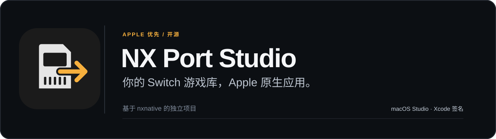
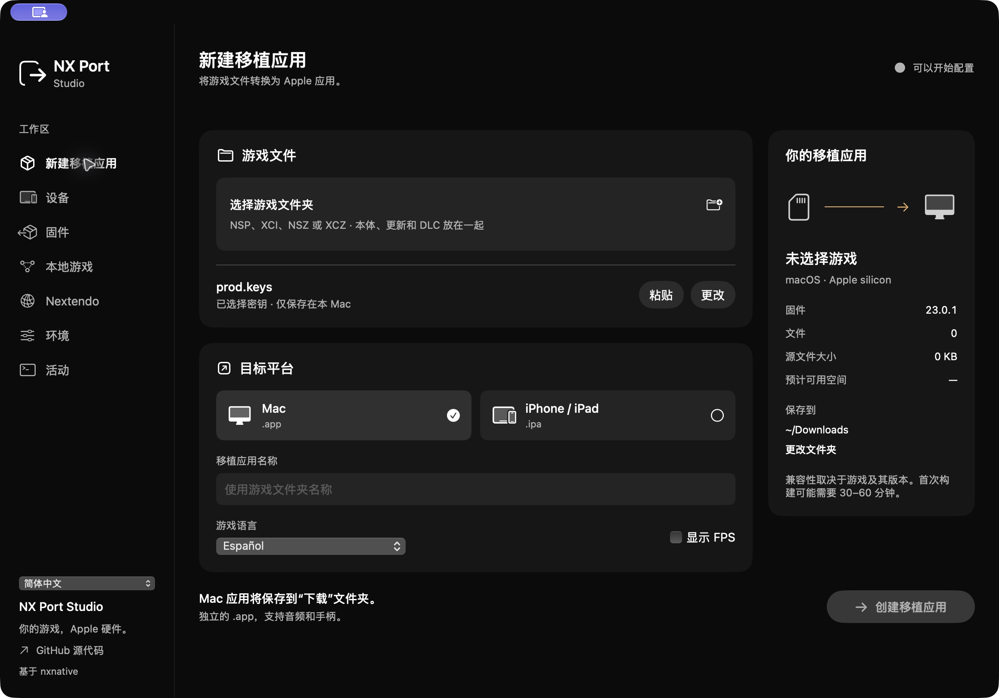
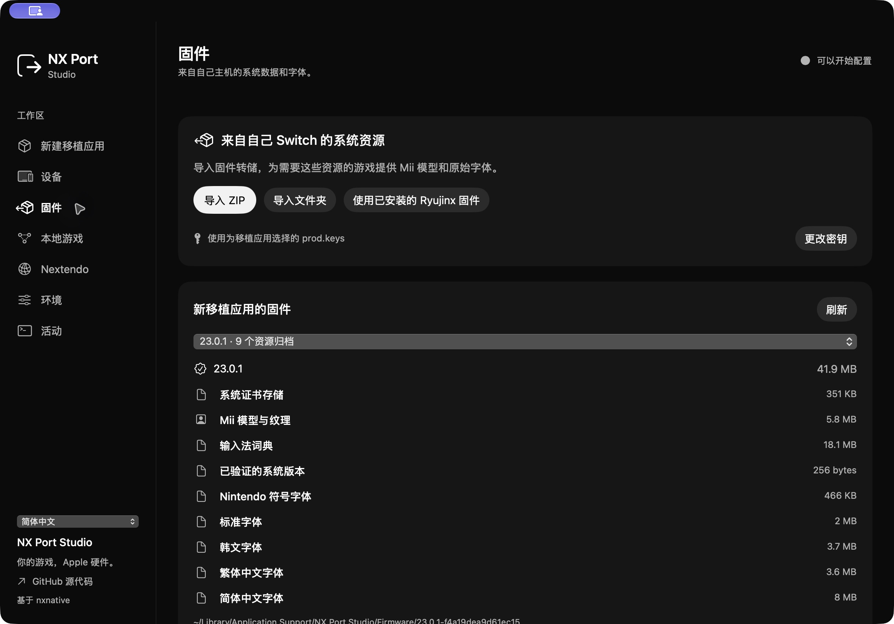
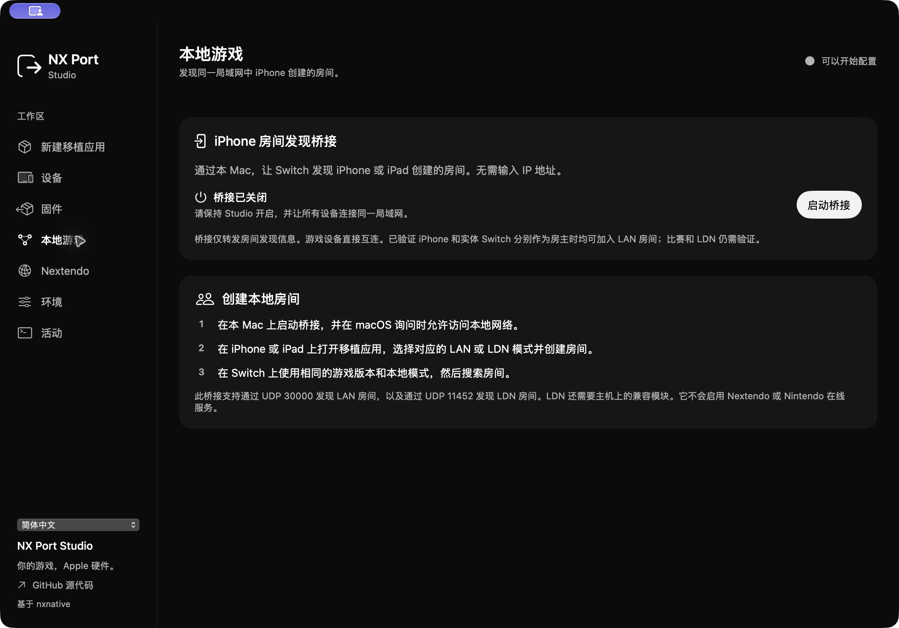

<a href="README.md">English</a> · <a href="README.es.md">Español</a> · <a href="README.fr.md">Français</a> · <a href="README.ja.md">日本語</a> · <strong>简体中文</strong>

**NX Port Studio 可将你自己拥有的 Nintendo Switch 游戏文件制作成 Apple 平台的原生应用。** macOS 工作台整合了资源准备、构建、控制器设置，以及通过 Xcode 为 iPhone/iPad 应用签名的流程。

这是基于 [seedds/nxnative](https://github.com/seedds/nxnative) 的独立项目，保留了原引擎作者署名、MIT 许可和版权声明。请参阅[致谢](CREDITS.md)与[许可证](LICENSE)。

> **1.6.0 候选版本：**引擎已同步至 nxnative `d2a86b05ccce`（自共同基线以来共352次提交）。主机、图形与 iOS 自动测试通过；新引擎仍需逐款游戏重新验证。[版本说明](docs/releases/1.6.0-rc.2.md)。

## 应用截图

界面默认使用西班牙语，也可切换为英语、法语、日语或简体中文。界面语言与游戏语言分别设置。

| 系统资源 | 本地房间发现 |
| :---: | :---: |
|  |  |

## 主要功能

- 识别 ZIP/7z、子文件夹及大写扩展名，限制解压范围并验证完整性。已知构建错误会以五种界面语言提供处理步骤。
- 每个游戏使用独立文件夹，集中管理本体、更新与 DLC，并显示实际构建进度和错误。
- iOS 导出必须经过 Xcode 签名和验证，之后才能报告成功。
- 导入自己主机中的 Mii 模型、字体、证书等系统资源。
- 根据系统与设备开放的能力提供按键映射、体感和振动。
- 实现原生网络传输、LAN/LDN 房间发现，以及实验性的 Nextendo 集成。
- 可在 iPhone/iPad 内通过系统浏览器连接 Nextendo，将账户保存在应用钥匙串中，并检查游戏与服务要求。

项目同时扩展了引擎中的 Horizon 套接字、HLE 等待处理、TLS 验证、账户和 Joy-Con 支持。具体兼容性取决于游戏、更新版本与设备。

## 验证状态

| 功能 | 已确认的结果 |
| --- | --- |
| Mac ↔ Switch LAN | 较早的 Mac 构建曾与实体 Switch 完成 Mario Kart 8 Deluxe 3.0.5 的完整比赛。当前候选构建已确认可以创建房间并进入主机规则界面。 |
| iPhone ↔ Switch LAN | 用户已确认双方都能作为房主，让另一台设备加入房间。该组合尚未确认完成整场比赛。 |
| LDN／本地无线 | 用户于10月31日确认，Mario Kart 3.0.5 在 Mac/iOS 原生移植版与实体 Switch 之间的 LAN 和 LDN 游戏成功。结果来自同步前的移植版，新引擎仍需重新验证；IP LDN 需要兼容的主机模块。 |
| Nextendo | 账户集成及 **Mac 版 Smash 13.0.5 的一轮真实竞技场对战**已验证。该服务的特定证书经过明确授权；此结果不代表快速匹配、其他游戏或 iOS 在线功能已验证。 |
| Android／Windows | 计划在 Apple 平台稳定后开发，目前没有可用构建；ARM 与 x86 需要分别实现。 |

移植版默认自动启用连接服务。直接在游戏内选择在线、本地无线或 LAN，无需另外选择模式或重启。Nextendo 配置独立提供；缺少在线凭据不会阻止本地游戏。停用网络和可选的发现地址保留在高级设置中。

LAN 需要相同的游戏版本和同一局域网，局域网本身不必连接互联网。LDN 的 IP 桥接需要主机端的兼容模块，与游戏自带的 LAN 模式是不同的机制。

截至 2026 年 10 月 31 日，已验证 5 个生产服务的原生 TLS 握手。部分 NEX 与认证服务仍存在证书链问题。已纳入全部 58 个目录条目、62 个地区配置与 22 个精确构建补丁方案；原生在线对局仍待验证。现有 Mario Kart 3.0.5 不满足服务要求的 4.0.1。[完整覆盖情况](docs/nextendo-coverage.md)列出了实际状态。

## 开始使用

Studio 需要 Apple silicon Mac、macOS 14 或更新版本，以及支持 Swift 6 的 Xcode。你需要自行提供游戏文件和主机密钥。当前 iOS 目标为 iOS/iPadOS 26 及受支持的硬件；部分游戏还需要更新的 macOS 或 Metal。

在仓库中运行：

    cd macOS/NXPortStudio
    swift test
    swift run NXPortStudio

在 Studio 中准备环境，选择游戏文件夹与 prod.keys，再选择 Mac 或 iPhone/iPad。iOS 构建还需要配置 Xcode 开发团队和已配对的设备。IPA 只有通过签名与验证后才会被视为成功，并受 Apple 的账户、设备和有效期规则限制。

公开仓库包含源代码、工具和 Studio 界面截图。游戏、主机密钥、固件、账户信息、存档及 Nintendo 图像不进入公开仓库。

Mac 移植应用直接安装到**应用程序**。临时引擎、解压数据和构建产物会在完成、失败或取消后删除。更新时先验证新应用，再替换同一游戏的移植版；存档和设置会保留。iOS 继续使用 Xcode 签名流程。

[完整英文指南](README.md) · [路线图](ROADMAP.md) · [参与开发](CONTRIBUTING.md)
